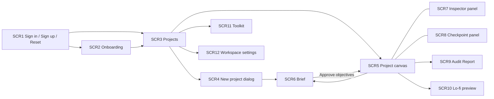

# 03: UX flows

*Plain English: every screen, what it shows in each situation, how people move through it, what happens when things go wrong, and the exact words on screen.*

Feature: Fluently MVP | Platform: web app | Version: 1 | Date: 2026-11-16 | Status: draft

---

## 1. Navigation map

Global sidebar (all signed-in screens; changed from a top bar on 2026-11-17 with the calm direction, 03b SCR3): Fluently logo (→ Home), search (⌘K), *Home*, *Projects*, *Toolkit*, *Settings*, recent projects, *How Fluently works* (→ SCR2), account menu (*Sign out*), *Collapse*. Inside a project, a project header adds: project name, mode · channel, toolkit version, cost so far, tabs *Canvas* / *Brief* / *Report*.

## 2. Screen inventory

| SCR | Screen | Purpose | Entry points | Main action | Stories |
|---|---|---|---|---|---|
| SCR1 | Sign in / Sign up / Reset password | Get allowlisted members in | Any URL while signed out | Sign in | US1 |
| SCR2 | Onboarding (3 steps, modal over SCR3) | Explain tree, checkpoints, trace | First sign-in; help menu | *Start my first project* | US2 |
| SCR3 | Projects | See and open all team projects | Sign-in; logo | *New project* | US7, US25 |
| SCR4 | New project (dialog) | Name, mode, channel | SCR3 | *Create project* | US7 |
| SCR5 | Project canvas | The OST: watch, edit, trace, decide | SCR3; after SCR6 approval | Depends on stage (SCR8) | US9–US26 |
| SCR6 | Brief | Objectives with coaching, audience, assets | SCR4; *Brief* tab | *Approve objectives* | US8, US9, US10 |
| SCR7 | Inspector (right panel on SCR5) | Full node content, sources, history, actions | Select a node | Edit / Regenerate / Trace | US12, US16, US22–US24, US26 |
| SCR8 | Checkpoint panel (bottom panel on SCR5) | Say what's done and what to decide | Stage completes; stage running | Approve / Send back | US14, US17, US20, US21, US25 |
| SCR9 | Audit Report | Readable report from the graph | *Report* tab | Read; (Should) Export | US15, US12 |
| SCR10 | Lo-fi preview (full screen) | Inspect a variant with pins | Open a lo-fi node | Click a pin → trace | US18–US20, US23 |
| SCR11 | Toolkit | Upload versions; browse; candidates; enrichments | Top bar | *Upload new version* (admin) | US4–US6, AC12.9 |
| SCR12 | Workspace settings | Allowlist, members, models, cost, usage, services, sector lists | Top bar | Save | US3, US27, US28, AC10.4, AC13.3 |

## 3. State matrix per screen

Copy keys in `[brackets]` are written out in §7.

### SCR1 Sign in / Sign up / Reset
| State | User sees | Can do |
|---|---|---|
| Default | Email, password, *Sign in*; links *Create account*, *Forgot password* | Sign in |
| Loading | Button shows spinner, label "Signing in…", fields disabled | Wait |
| Error: wrong credentials | `[auth.wrongCredentials]` above form | Retry |
| Error: not allowlisted (sign-up) | `[auth.notAllowed]` | Use another email |
| Success: sign-up | `[auth.checkEmail]` | Open email |
| Reset sent | `[auth.resetSent]` | Back to sign in |
| Error: link expired | `[auth.linkExpired]` with *Send a new link* | Resend |
| Offline | `[common.offline]` banner; submit disabled | Wait |

### SCR2 Onboarding
| State | User sees | Can do |
|---|---|---|
| Step 1 "One tree, from brief to wireframe" | Diagram of the 7 columns | *Next*, *Skip* |
| Step 2 "You decide at every checkpoint" | Approve / Edit / Send back explained | *Back*, *Next*, *Skip* |
| Step 3 "Everything traces back" | A pin, highlighted path to evidence and objectives | *Back*, *Start my first project* (→ SCR4) |

### SCR3 Projects
| State | User sees | Can do |
|---|---|---|
| Loading | 5 skeleton rows | — |
| Empty (first use) | `[projects.emptyTitle]`, `[projects.emptyBody]`, *New project* | Create |
| Default | Table: name, mode · channel, stage, status chip, last edited by · when; filter *Active* / *Archived*; search | Open, archive, create |
| Empty (no results) | `[projects.noResults]` with *Clear search* | Clear |
| Error | `[common.loadFailed]` with *Try again* | Retry |
| No toolkit yet (admin) | Banner `[toolkit.noneYet]` with *Upload toolkit* | Go to SCR11 |
| No toolkit yet (member) | Banner `[toolkit.noneYetMember]` | — |

### SCR4 New project dialog
| State | User sees | Can do |
|---|---|---|
| Default | Name; Mode radio (*Create something new* / *Optimise something that exists*); Channel radio (*Screens and flows* / *Email*); Client label (optional) | Create, cancel |
| Invalid | Inline `[project.nameInvalid]` | Fix |
| Saving | Button spinner "Creating…" | Wait |
| Error | `[common.saveFailed]` | Retry |

### SCR5 Project canvas
| State | User sees | Can do |
|---|---|---|
| Loading | Column headers + skeleton nodes | — |
| Intake not approved | Objectives column with placeholder `[canvas.intakeFirst]` and *Go to brief* | Go to SCR6 |
| Ethics running | Ethics node with spinner "Checking the brief against our ethics rules…" | Wait |
| Ethics flagged | Ethics node flagged; SCR8 shows reasons | Edit brief, override |
| Ready to research | SCR8 `[checkpoint.readyResearch]` | *Start research* |
| Stage running | Column header progress (`Academic papers · 12 found`), nodes appear live; *Cancel* in SCR8 | Watch, inspect finished nodes, cancel |
| Stage partially failed | SCR8 `[stage.partialFail]` listing failed steps | *Retry failed steps*, continue |
| Stage failed | SCR8 `[stage.failed]` | *Retry*, *Get help* (copies error ID) |
| Checkpoint waiting | SCR8 with decision content | Approve, edit, send back |
| Stale nodes present | Stale marker on nodes; toolbar *Update out-of-date cards (n)* | Update, ignore |
| Trace mode | Path highlighted, others dimmed at 30% opacity | Escape to clear |
| Cost near cap | Header chip `[cost.nearCap]` | — |
| Cost at cap | SCR8 `[cost.atCap]` | Confirm continue / admin raises cap |
| Offline | `[common.offline]` banner; edits disabled | Wait |
| Session expired | `[common.sessionExpired]` modal | Sign in (returns here) |
| Card expanded | The card grows in place (Evidence: sources grouped by kind; Current assets: each asset, draggable to another assets card); a collapse arrow top-right | Collapse, open a source, *Add source* |
| Dragging a connection | Valid target cards in the next lane stay sharp, others fade; the line follows the pointer | Drop on a card, or release to cancel |
| Line hovered | Line darkens; a small remove button at its midpoint | Remove the connection |
| List view (accessibility toggle) | Nodes as nested lists by column with the same actions | Everything the canvas allows |
| Complete | Header chip "Complete"; SCR8 `[checkpoint.complete]` | Edit anything, rate (NFR12) |

### SCR6 Brief
| State | User sees | Can do |
|---|---|---|
| Default (new mode) | Fields per AC8.1 except assets; helper text under each | Type, upload |
| Default (optimise mode) | Plus *Current assets* section (screens: images + Figma link; email: paste HTML / upload `.html` `.eml` / images) | Upload |
| Coaching loading | Under the field: "Looking for a sharper version…" with spinner | Keep typing |
| Coaching suggestion | Card: suggestion, "Why: …", *Use suggestion* / *Edit suggestion* / *Keep mine* | Choose |
| Coaching unavailable | `[intake.coachUnavailable]` | Continue |
| Low specificity kept | Field chip `Low specificity` + `[intake.lowSpecificityNote]` | Edit later |
| Upload in progress | File row with progress bar | Cancel upload |
| Upload rejected | File row `[upload.typeOrSize]` | Remove, retry |
| Autosave | "Saving…" / "Saved just now" / `[common.saveFailed]` with *Try again* | — |
| Ready | *Approve objectives* enabled | Approve |
| Missing objective | *Approve objectives* disabled, `[intake.needsObjectives]` | Fill |
| Approved | Read-only summary with *Edit brief* and *Go to canvas* (edit warns `[intake.editWarnsStale]` if later stages exist) | Edit |
| Ethics result: flagged | Panel listing reasons, *Edit brief*, *Override with a reason* | Edit, override |
| Ethics result: refused sector | `[ethics.refusedSector]`; no override | Archive project |
| Ethics check failed | `[ethics.checkFailed]` + *Try again* | Retry |

### SCR7 Inspector
| State | User sees | Can do |
|---|---|---|
| Default | Type, title, body, markers, sources list, principle(s), linked objectives, provenance, model used, history | Edit, Regenerate, Trace, Delete, Merge (multi-select), Override (if flagged) |
| Editing | Fields editable; *Save* / *Cancel* | Save |
| Saving | "Saving…" | — |
| Save conflict | `[canvas.editConflict]` + *See latest*; your text kept | Compare, re-apply |
| Locked (stage running) | `[canvas.lockedWhileRunning]`; edit controls disabled | Read |
| Regenerating | Spinner on node and inspector "Regenerating…" | Wait |
| Regenerate failed | `[node.regenerateFailed]` + *Try again* | Retry |
| Flagged | Flag reason + *Override with a reason* | Override |
| Override form | Reason textarea (≥ 20 chars), counter, *Record override* | Submit |
| Multi-select | "n nodes selected" + *Merge* (same type only) / *Delete* | Merge |

### SCR8 Checkpoint panel
| State | User sees | Can do |
|---|---|---|
| Ready to research | `[checkpoint.readyResearch]` | *Start research* |
| Running | Stage name, step list with ✓ / spinner / ✕, elapsed time, cost so far | *Cancel*, *See what it's doing* |
| Activity (added 2026-11-17, AC11.10) | Side panel: research questions, then the activity log, newest at the bottom, live | Close; open again after the run |
| Research checkpoint | "Choose the opportunities to pursue", list with checkboxes, confidence, gaps count | Approve, send back |
| Nothing selected | Button disabled + `[checkpoint.selectAtLeastOne]` | Select |
| Solutions checkpoint | Recommendations by opportunity, select/edit/add | Approve, send back |
| Lo-fi checkpoint | Variants side by side, approve per variant | Approve, send back |
| Test plan checkpoint | Plan summary; if needed, baseline inputs `[testplan.needsBaseline]` | Approve |
| Send back form | Feedback (≥ 10 chars), checkbox *Also replace nodes people added or edited* (off) | *Send back* |
| Partial failure / failed / cancelled | `[stage.partialFail]` / `[stage.failed]` / `[stage.cancelled]` | Retry |
| Complete | `[checkpoint.complete]` + rating 1–5 (once) | Rate, close |
| Collapsed / minimised | One line: what's waiting, count, main action | *Show what's next*, *Expand* |
| Expanded (added 2026-11-17, AC25.5) | Full height over the canvas, same content | *Minimise*, *Standard size* |

### SCR9 Audit Report
| State | User sees | Can do |
|---|---|---|
| Loading | Skeleton paragraphs | — |
| Not yet | `[report.notYet]` | Back to canvas |
| Default | Sections per AC15.1, citation markers `[1]` linking to a source list; `AI independent inference` labels; strength and confidence tags (AC12.12); low-specificity labels; gaps summary grouped Discovery / Generative (AC13.5) | Read, open citation, trace, *Download* (Markdown or PDF) |
| Stale content | Banner `[report.hasStale]` | Go to canvas |
| Citation check | Table of every citation with record and link | Open links |
| Exporting | `[report.exporting]` | Wait |
| Export failed | `[report.exportFailed]` | Retry |

### SCR10 Lo-fi preview
| State | User sees | Can do |
|---|---|---|
| Loading | Grey frame with spinner | — |
| Default | Variant in a frame (390 px; toggle 1280 px; email 600 px with subject and preview text above), numbered pins; annotation list on the right | Click pin, switch variant |
| Pin selected | Annotation card (What, Principle, Evidence, → objectives, Ethics) + *Trace* | Trace (→ SCR5 trace mode) |
| Render failed | `[lofi.renderFailed]` + *Regenerate* | Regenerate |
| Same principle warning | `[lofi.samePrinciple]` | Regenerate one |
| Flagged | Ethics flag banner + *Override with a reason* | Override |

### SCR11 Toolkit
| State | User sees | Can do |
|---|---|---|
| Empty (admin) | `[toolkit.emptyAdmin]` + *Upload toolkit* | Upload |
| Empty (member) | `[toolkit.noneYetMember]` | — |
| Default | Versions list (number, date, uploader, principles, evidence-level counts, *Default* chip); browser (Should); *Toolkit candidates* tab; *Enrichments* tab (Should) | Browse, upload (admin) |
| Validating | "Checking your file…" | Wait |
| Preview valid | Counts, warnings list, *Save as version n* | Confirm |
| Preview invalid | Errors by row `[toolkit.errorMissingId]` etc.; *Choose another file* | Re-upload |
| Saving | "Saving version n…" | — |
| Saved | Toast `[toolkit.saved]` | — |

### SCR12 Workspace settings
| State | User sees | Can do |
|---|---|---|
| Default (admin) | Sections: Allowlist; Members; Models per stage; Cost cap and GBP rate; Agency services; Sector lists (flag / refuse); Usage (per project, per stage) | Edit, save |
| Default (member) | Usage read-only | — |
| Invalid entry | `[settings.invalidAllowEntry]` | Fix |
| Last admin | `[settings.lastAdmin]` | — |
| Saved | Toast `[common.saved]` | — |
| Save failed | `[common.saveFailed]` | Retry |

## 4. Flows

Format: user action → system response → resulting state (ACs).

### FL1 First sign-in and onboarding (JS1, JS2)
1. Person opens Fluently → SCR1 → *Create account*, enters allowlisted email + password → verification email sent, `[auth.checkEmail]` (AC1.1).
2. Clicks link → verified, signed in → SCR2 step 1 (AC2.1).
3. *Next* ×2 → *Start my first project* → SCR4 (AC2.2).

### FL2 Brief to research ready (JS1, JS6)
1. In SCR4, enters name, mode, channel → *Create project* → SCR6 (AC7.1).
2. Types behavioural objective, leaves field → "Looking for a sharper version…" → suggestion card (AC8.2).
3. *Use suggestion* → field updated, Saved (AC8.3, AC8.9).
4. Repeats for business objective, audience, constraints; uploads client reviews CSV (AC8.8). Optimise mode: uploads screenshots (AC8.6).
5. *Approve objectives* → objective nodes created; ethics node "Checking…" on SCR5 (AC9.2, AC10.1).
6. Ethics passes → SCR8 `[checkpoint.readyResearch]` (AC10.2).

### FL3 Research to Audit Report (JS2, JS3)
1. *Start research* → stage `running`; SCR8 lists steps (AC11.1).
2. Source and finding nodes appear in columns as each step completes (AC11.2). Member may close the tab (AC11.3).
3. Synthesis → theme, opportunity and gap nodes appear (AC12.5, AC13.1); confidence computed (AC12.6).
4. SCR8 research checkpoint opens; project shows `waiting for you` (AC14.1, AC25.4).
5. Member opens *Report* tab → SCR9 (AC15.1). Opens a citation → source record (AC15.2).
6. Selects 2 opportunities → *Approve and generate solutions* (AC14.3).

### FL4 Recommendations (JS3)
1. Solutions stage runs; recommendation nodes appear per opportunity (AC16.1).
2. Checkpoint: member edits one (provenance → Edited, AC24.1), adds one with a principle from the picker (AC17.2), deselects one.
3. *Approve and make wireframes* (AC17.4).

### FL5 Lo-fi (JS4)
1. Lo-fi stage runs; variant nodes appear with thumbnails (AC18.1).
2. Member opens a variant → SCR10; clicks pin 3 → annotation card (AC18.3); *Trace* → SCR5 trace mode with path highlighted (AC23.1).
3. Checkpoint: approves one variant per recommendation (AC20.2).

### FL6 Test plan and completion (JS5)
1. Test plan stage runs → test plan node (AC21.1). If baseline missing, SCR8 asks for it (AC21.2).
2. Member enters baseline 12% → sample size computed → *Approve plan* → project `complete`, rating prompt (AC21.3, NFR12).

### FL7 Toolkit upload (admin) (JS3)
1. SCR11 → *Upload new version* → selects CSV → "Checking your file…" (AC4.1).
2. Preview: 214 principles, 3 warnings (unknown columns ignored; 2 related principles not found) (AC4.4, AC4.7).
3. *Save as version 2* → saved; default for new projects; existing projects stay pinned (AC4.5, AC7.4).

### Alternate flows
- **ALT1 Returning member:** sign-in → SCR3 directly (AC1.3).
- **ALT2 Keep mine:** member keeps vague objective → `Low specificity` chip carried to all outputs (AC8.5).
- **ALT3 Send back:** at any checkpoint, *Send back with feedback* → stage re-runs with feedback, people's nodes kept (AC25.2).
- **ALT4 Edit upstream later:** member edits an approved objective → `[intake.editWarnsStale]` → confirm → downstream nodes stale, intake checkpoint re-opens (AC9.3, AC24.4).
- **ALT5 Email project:** FL5 produces email variants with subject and preview text (AC19.1–AC19.2).
- **ALT6 Optimise mode:** the brief requires current assets; lo-fi annotates changes vs current (AC8.6, AC18.6).
- **ALT7 Member (not admin) on SCR12:** sees usage only (AC3.6).

### Failure flows

| FF | Trigger | System behaviour | User feedback | Recovery | Can continue? |
|---|---|---|---|---|---|
| FF1 | Sign-up with non-allowlisted email; or expired verification link | No account / link refused | `[auth.notAllowed]` / `[auth.linkExpired]` | Ask an admin; *Send a new link* | Partly |
| FF2 | Coaching call fails or > 20 s | Keeps text (AC8.4) | `[intake.coachUnavailable]` | Continue without suggestion | Yes |
| FF3 | Upload wrong type / too big / > file limit | Reject that file (AC8.7) | `[upload.typeOrSize]` / `[upload.tooMany]` | Choose another file | Yes |
| FF4 | Ethics flag; or ethics check fails | Block research (AC10.3, AC10.5) | Reasons list / `[ethics.checkFailed]` | Edit brief, override with reason, or retry | Partly |
| FF5 | Research step fails after 2 retries (e.g. Semantic Scholar rate limit) | Step `failed`, others continue, confidence lowered (AC11.4–AC11.5) | `[stage.partialFail]` | *Retry failed steps* or continue | Yes |
| FF6 | Synthesis fails; job > 30 min; worker crash | Stage `failed`, partial nodes kept (AC11.6, NFR8) | `[stage.failed]` | *Retry synthesis* | Yes after retry |
| FF7 | Recommendation without valid principle after 1 retry | Not shown; logged (AC16.2) | If an opportunity ends with 0 recommendations: `[rec.noneValid]` on that opportunity | *Regenerate* or add one by hand | Yes |
| FF8 | Lo-fi variant fails to render / too big / no valid annotations | Variant `failed`, others kept (AC18.4, AC18.8) | `[lofi.renderFailed]` | *Regenerate* | Yes |
| FF9 | Toolkit file invalid | Nothing saved (AC4.2–AC4.3) | Row-level errors | Fix file, re-upload | Yes |
| FF10 | Edit conflict | Save refused, text kept (AC24.7) | `[canvas.editConflict]` | *See latest*, re-apply | Yes |
| FF11 | Delete with dependents | Confirm, then delete + stale, Undo 10 s (AC24.5) | `[canvas.deleteConfirm]`, `[canvas.deleted]` | *Undo* | Yes |
| FF12 | Cost cap reached | Pause before next AI call (AC27.4) | `[cost.atCap]` | Member confirms or admin raises cap | Partly |
| FF13 | Network lost while editing | Edits queued in the editor, not lost; save retried on reconnect | `[common.offline]`, then `[common.saveFailed]` if retry fails | *Try again* | Partly |
| FF14 | Session expires mid-edit | Unsaved text kept in the editor | `[common.sessionExpired]` | Sign in in a modal; save resumes | Yes |
| FF16 | Member drops a line on a card that can't accept it, or removes a line a card needs | Nothing changes (AC30.3, AC30.5) | `[canvas.cantConnect]` / `[canvas.linkRequired]` | Connect to a valid card, or add another link first | Yes |
| FF15 | Lo-fi tries to load external resources | Blocked by sandbox (NFR6) | Missing image shows grey placeholder | None needed | Yes |

## 5. Edge cases

| EC | Situation | Expected behaviour | AC |
|---|---|---|---|
| EC1 | New toolkit version uploaded while a project is mid-way | Project stays on its pinned version; header shows "Toolkit v1 (newer v2 available)" | AC7.4 |
| EC2 | No toolkit uploaded yet | Projects can be created and the brief done; research blocked with `[toolkit.noneYet]` | AC4.9 |
| EC3 | Academic search returns 0 relevant papers | Step completes with "0 papers found"; confidence reflects fewer source types; gaps more likely | AC11.4, AC12.6 |
| EC4 | All opportunities are Low confidence | All remain selectable, labelled; SCR8 notes `[checkpoint.allLow]` | AC13.4 |
| EC5 | Sources contradict (e.g. reviews praise speed, analytics shows drop-off) | Confidence Low; gap node states the contradiction | AC12.6, AC13.1 |
| EC6 | Two members edit the same node | Second save refused | AC24.7 |
| EC7 | Objective edited after lo-fi exists | All downstream nodes stale; nothing deleted | AC9.3, AC24.4 |
| EC8 | Member deactivated while their stage runs | Job continues; output attributed to them; others can act at checkpoints | AC3.4 |
| EC9 | Sector on refuse list | Project blocked, no override | AC10.4 |
| EC10 | Screenshot contains a real customer's personal data | Privacy hint at upload; data kept private; deleted with project | NFR7 |
| EC11 | Model cites principle ID that doesn't exist (e.g. "P-999") | Rejected by code check | AC16.2, AC18.4 |
| EC12 | Two variants use the same principle | Regenerate once, else warn | AC18.5 |
| EC13 | Send back while people have edited/added nodes | Their nodes kept unless they tick "Also replace…" | AC25.2 |
| EC14 | Very large project (> 1,000 nodes) | Canvas still usable; list view available; trace ≤ 300 ms target at 1,000 | NFR2, AC23.2 |
| EC15 | Test plan with unknown baseline | Ask; never invent | AC21.2 |
| EC16 | Merge themes linked to different findings | Merged theme keeps the union of links | AC24.6 |
| EC17 | Research surfaces a principle not in the toolkit | Shown as external principle; listed as toolkit candidate | AC12.9 |
| EC18 | Member closes the tab during a run | Job continues; state shown on return | AC11.3 |
| EC19 | Paper found but no abstract available | Listed as a source; not used for findings unless its full text is fetched | AC12.2 |
| EC20 | Brief or sources not in English | `[Assumption]` v1 outputs in English; non-English sources summarised in English and marked "(translated)" | AC12.2 |
| EC21 | Same opportunity has a Low confidence label and a low-specificity objective | Both labels shown, each once | AC16.5 |
| EC22 | Member tries to delete an objective node | Refused; points to the brief | AC24.8 |

## 6. Interactions and validation

| Input | Required | Format / limits | Validated | Error copy |
|---|---|---|---|---|
| Email (SCR1) | Yes | Valid email, ≤ 254 chars | On submit | `[auth.invalidEmail]` |
| Password (SCR1 sign-up) | Yes | ≥ 12 chars | On leaving field and submit | `[auth.passwordShort]` |
| Project name (SCR4) | Yes | 1–80 chars | On submit | `[project.nameInvalid]` |
| Business objective (SCR6) | Yes to approve | 10–500 chars | Coach on leaving field; required on approve | `[intake.needsObjectives]` |
| Behavioural objective (SCR6) | Yes to approve | 10–500 chars | As above | `[intake.needsObjectives]` |
| Audience and context | No | ≤ 1,500 chars | Coach on leaving field | — |
| Constraints | No | ≤ 1,500 chars | Coach on leaving field | — |
| Sector | Yes to approve | Pick from list or "Other" + text | On approve | `[intake.needsSector]` |
| Current assets (optimise) | Yes to approve | Per AC8.6 | On upload; required on approve | `[upload.typeOrSize]`, `[intake.needsAssets]` |
| Figma link | No | `https://www.figma.com/…` | On leaving field | `[intake.figmaLinkInvalid]` |
| Client data | No | Per AC8.8 | On upload | `[upload.typeOrSize]`, `[upload.tooMany]` |
| Override reason | Yes | ≥ 20 chars | On type (counter) | `[ethics.reasonTooShort]` |
| Send-back feedback | Yes | ≥ 10 chars | On type | `[checkpoint.feedbackShort]` |
| Recommendation (added) | Yes | Idea 10–400 chars; ≥ 1 principle | On save | `[rec.needsPrinciple]` |
| Allowlist entry | Yes | Email or `@domain.tld` | On add | `[settings.invalidAllowEntry]` |
| Cost cap | Yes | £1–£500 | On save | `[settings.capInvalid]` |
| Variants per recommendation | Yes | 1–3 | On change | — (stepper) |
| Baseline rate (test plan) | When asked | 0.1–99.9 % | On submit | `[testplan.baselineInvalid]` |

## 7. Microcopy

| Key | Copy |
|---|---|
| auth.notAllowed | "This email isn't on Fluently's invite list. Ask your Fluently admin to add you." |
| auth.wrongCredentials | "That email and password don't match. Check them and try again." |
| auth.resetSent | "If that email has a Fluently account, a reset link is on its way." |
| auth.checkEmail | "Check your inbox. We've sent a link to confirm your email." |
| auth.linkExpired | "This link has expired. We can send you a new one." |
| auth.invalidEmail | "Enter an email address like name@company.com." |
| auth.passwordShort | "Use at least 12 characters." |
| common.offline | "You're offline. Changes will save when you reconnect." |
| common.saveFailed | "Couldn't save. Check your connection and try again." |
| common.saved | "Saved." |
| common.loadFailed | "Couldn't load this. Try again in a moment." |
| common.sessionExpired | "You've been signed out. Sign in again to keep working; nothing you typed is lost." |
| projects.emptyTitle | "No projects yet" |
| projects.emptyBody | "Start with a brief. Fluently will help you sharpen the objectives, then research, recommend and wireframe, with every step traced to evidence." |
| projects.noResults | "No projects match that search." |
| project.nameInvalid | "Give the project a name of up to 80 characters." |
| toolkit.noneYet | "Upload the Behavioural Design Toolkit before running research. Fluently cites every principle from it." |
| toolkit.noneYetMember | "Research is waiting for the toolkit. Ask your Fluently admin to upload it." |
| toolkit.emptyAdmin | "No toolkit yet. Upload a CSV or JSON export of the Behavioural Design Toolkit. Each upload becomes a read-only version." |
| toolkit.errorMissingId | "Row {row}: the ID is empty. Every principle needs a stable ID." |
| toolkit.errorDuplicateId | "Rows {rows}: the ID \"{id}\" is used more than once. IDs must be unique." |
| toolkit.errorMissingColumns | "This file is missing required columns: {columns}." |
| toolkit.saved | "Toolkit version {n} saved. New projects will use it." |
| intake.coachUnavailable | "Suggestions aren't available right now. Your text is saved, and you can carry on." |
| intake.lowSpecificityNote | "Kept as written. It'll be marked 'low specificity' on everything that uses it." |
| intake.needsObjectives | "Add both a business objective and a behavioural objective to continue." |
| intake.needsSector | "Choose the client's sector so we can check it against our ethics rules." |
| intake.needsAssets | "Add at least one current screen or email so Fluently knows what to optimise." |
| intake.figmaLinkInvalid | "That doesn't look like a Figma link. It should start with https://www.figma.com/." |
| intake.editWarnsStale | "Changing the brief will mark everything built from it as out of date. You can update those parts afterwards." |
| intake.uploadPrivacyHint | "Remove names, emails and other personal details before uploading. Uploads stay inside your workspace." |
| upload.typeOrSize | "\"{file}\" can't be added. Use {types} up to {size}." |
| upload.tooMany | "You can add up to {n} files here." |
| ethics.refusedSector | "Fluently doesn't take on work in this sector. Talk to your Fluently admin if you think this is wrong." |
| ethics.checkFailed | "The ethics check didn't run. Research stays paused until it does." |
| ethics.reasonTooShort | "Explain your reason in at least 20 characters. It's recorded on the canvas." |
| checkpoint.readyResearch | "Objectives approved and the ethics check passed. Next: research. It runs in the background and usually takes 10–20 minutes." |
| checkpoint.selectAtLeastOne | "Choose at least one opportunity to continue." |
| checkpoint.allLow | "Every opportunity has low confidence. You can still go ahead; the labels will carry through." |
| checkpoint.feedbackShort | "Tell Fluently what to change, in at least 10 characters." |
| checkpoint.complete | "Test plan approved. This project is complete, and you can still edit any part of it." |
| stage.partialFail | "Research finished, but {steps} didn't work. Confidence is lower where those sources are missing." |
| stage.failed | "{stage} stopped before it finished. Everything made so far is kept." |
| stage.cancelled | "{stage} was cancelled. Everything made so far is kept." |
| canvas.intakeFirst | "Start with the intake. Your objectives will appear here." |
| canvas.lockedWhileRunning | "This is being worked on right now. You can edit it once {stage} finishes." |
| app.desktopOnly | "Fluently works on laptop and desktop screens. Open it on a computer, or make this window wider." *(added 2026-11-16, please confirm)* |
| canvas.deleteConfirm | "Delete this {type}? {n} items built from it will be marked out of date." |
| canvas.deleted | "{type} deleted." (with *Undo*) |
| canvas.editConflict | "{name} changed this while you were editing. Your text is still here; see the latest version before saving." |
| canvas.cantDeleteObjective | "Objectives can't be deleted. Change them in the brief instead." |
| node.regenerateFailed | "Couldn't regenerate this. The previous version is unchanged." |
| rec.needsPrinciple | "Choose at least one principle. Every recommendation needs one." |
| rec.noneValid | "No recommendation for this opportunity passed the principle check. Regenerate, or add one yourself." |
| lofi.renderFailed | "This wireframe didn't render. The other variants are fine." |
| lofi.samePrinciple | "These two variants rest on the same principle. Regenerate one for a real comparison." |
| report.notYet | "The Audit Report appears once research finishes." |
| report.hasStale | "Some parts of this report are out of date. Update them on the canvas." |
| report.exportFailed | "Export didn't work. Try again." |
| testplan.needsBaseline | "What's the current rate for {metric}? Fluently needs it to size the test, and won't guess." |
| testplan.baselineInvalid | "Enter a percentage between 0.1 and 99.9." |
| cost.nearCap | "This project has used {spent} of its {cap} AI budget." |
| cost.atCap | "This project has reached its {cap} AI budget. Continue anyway, or ask an admin to raise it." |
| settings.invalidAllowEntry | "Enter an email (name@company.com) or a domain (@company.com)." |
| settings.lastAdmin | "Fluently needs at least one admin. Make someone else an admin first." |
| settings.capInvalid | "Set a budget between £1 and £500." |

**Added during the build (Slice 0): please confirm this wording**

| Key | Copy |
|---|---|
| auth.signInTitle | "Sign in to Fluently" |
| auth.signUpTitle | "Create your Fluently account" |
| auth.resetTitle | "Reset your password" |
| auth.resetUpdateTitle | "Choose a new password" |
| auth.emailLabel | "Email" |
| auth.passwordLabel | "Password" |
| auth.newPasswordLabel | "New password" |
| auth.signIn | "Sign in" |
| auth.signingIn | "Signing in…" |
| auth.createAccount | "Create account" |
| auth.creatingAccount | "Creating account…" |
| auth.forgotPassword | "Forgot password" |
| auth.sendResetLink | "Send reset link" |
| auth.sendNewLink | "Send a new link" |
| auth.sending | "Sending…" |
| auth.saveNewPassword | "Save new password" |
| auth.saving | "Saving…" |
| auth.backToSignIn | "Back to sign in" |
| auth.haveAccount | "Already have an account? Sign in" |
| auth.signOut | "Sign out" |
| nav.projects | "Projects" |
| nav.toolkit | "Toolkit" |
| nav.settings | "Settings" |
| nav.account | "Account" (accessible name of the account menu button) |
| nav.main | "Main" (accessible name of the top navigation) |
| lane.objectives / lane.evidence / lane.themes / lane.opportunities / lane.solutions / lane.wireframes / lane.tests | "Objectives" / "Evidence" / "Themes" / "Opportunities" / "Solutions" / "Wireframes" / "Tests" |
| evidence.groups | "Client uploads" / "Academic papers" / "Web and market" / "Competitors" / "Reviews and forums" |
| evidence.addSource | "Add source" |
| evidence.addHint | "Upload a file or paste a link" |
| canvas.showMore | "Show {n} more" |
| assets.defaultName | "Current assets" |
| assets.count | "{n} screens" / "{n} emails" / "{n} assets" (mixed) |
| assets.split | "Split card" |
| assets.hint | "Select screens, then split them into their own card. Drag a screen onto another assets card to move it." *(added Slice 6, please confirm)* |
| lane.addCard | "Add a card to {lane}" (accessible name of the + button) |
| assets.uploadedBy | "Uploaded by {name}" |
| canvas.cantConnect | "These two can't be connected. Lines run from one stage to the next." |
| canvas.linkRequired | "This {type} needs at least one {required}. Connect another before removing this one." |
| canvas.removeLine | "Remove connection" (accessible name of the line's remove button) |

**Added during the build (Slice 1, 2026-11-17): please confirm this wording.** Home and sidebar wording comes from the approved mock-up.

| Key | Copy |
|---|---|
| nav.home | "Home" |
| nav.search | "Search" (shortcut ⌘K) |
| nav.help | "How Fluently works" |
| nav.collapse | "Collapse" |
| nav.expand | "Expand sidebar" |
| home.greeting | "Good morning, {name}" / "Good afternoon, {name}" / "Good evening, {name}" |
| home.waiting | "Waiting for you" |
| home.running | "Running" |
| home.recent | "Recent projects" |
| home.review | "Review" |
| home.open | "Open" |
| home.columns | "Name" / "Stage" / "Channel" / "Edited" |
| home.newProject | "New project" |
| home.nothingWaiting | "Nothing needs you right now." |
| stage.names | "Brief" / "Ethics check" / "Research" / "Solutions" / "Wireframes" / "Test plan" / "Complete" |
| waiting.intake | "Approve the objectives to start." |
| waiting.ethics | "The ethics check needs your decision." |
| waiting.research | "Research is done. Choose which opportunities to take forward." |
| waiting.solutions | "Solutions are ready. Choose which to turn into wireframes." |
| waiting.lofi | "Wireframes are ready to approve." |
| waiting.testplan | "The test plan is ready to approve." |
| running.line | "{stage} is running." |
| channel.names | "Screens" / "Email" |
| projects.title | "Projects" |
| projects.search | "Search projects" |
| projects.filterActive | "Active" |
| projects.filterArchived | "Archived" |
| projects.archive | "Archive" |
| projects.restore | "Restore" |
| projects.archived | "Project archived." |
| projects.restored | "Project restored." |
| status.names | "In progress" / "Waiting for you" / "Running" / "Failed" / "Complete" / "Blocked" |
| newProject.title | "New project" |
| newProject.name | "Project name" |
| newProject.mode | "What are you doing?" |
| newProject.modeNew | "Create something new" |
| newProject.modeNewHint | "Start from a brief with no existing design." |
| newProject.modeOptimise | "Optimise something that exists" |
| newProject.modeOptimiseHint | "Improve current screens or emails. You'll add them to the brief." |
| newProject.channel | "Channel" |
| newProject.channelScreens | "Screens and flows" |
| newProject.channelEmail | "Email" |
| newProject.client | "Client (optional)" |
| newProject.create | "Create project" |
| newProject.creating | "Creating…" |
| common.cancel | "Cancel" |
| common.close | "Close" (accessible name of a dialog's × button) |
| sidebar.waitingShort / sidebar.runningShort | "Decide" / "Running" (beside a project in the sidebar) |
| sidebar.account | "Account" (accessible name of the account menu) |
| projects.loadMore | "Load more" |
| toolkit.upload | "Upload toolkit" |
| time.relative | "just now" / "{n} min ago" / "{n} hours ago" / "Yesterday" / "3 Nov" (date for anything older) |
| projects.editedBy | "{time} by {name}" |
| onboarding.step1Title | "One tree, from brief to wireframe" |
| onboarding.step1Body | "Fluently turns a brief into objectives, evidence, themes, opportunities, solutions, wireframes and tests. Each stage is a lane on one canvas, read from left to right." |
| onboarding.step2Title | "You decide at every checkpoint" |
| onboarding.step2Body | "After each stage, Fluently stops and asks you to approve, edit or send it back with feedback. Nothing moves on without you." |
| onboarding.step3Title | "Everything traces back" |
| onboarding.step3Body | "Select any card to see the path back to its sources, the principle behind it and both objectives. If it has no principle, it doesn't ship." |
| onboarding.next | "Next" |
| onboarding.back | "Back" |
| onboarding.skip | "Skip" |
| onboarding.start | "Start my first project" |
| onboarding.stepOf | "Step {n} of 3" |

**Added during the build (Slice 2, 2026-11-17): please confirm this wording.** Settings page (SCR12).

| Key | Copy |
|---|---|
| settings.title | "Settings" |
| settings.allowlist / settings.allowlistHelp | "Who can join" / "People with these emails, or any email at these domains, can create an account. Removing one stops new sign-ups; existing accounts stay." |
| settings.allowlistLabel / settings.allowlistPlaceholder / settings.add / settings.remove | "Email or domain" / "name@company.com or @company.com" / "Add" / "Remove" |
| settings.allowlistEmpty | "No one can join yet. Add an email or a domain." |
| settings.members | "Members" |
| settings.roleAdmin / settings.roleMember / settings.you | "Admin" / "Member" / "You" |
| settings.makeAdmin / settings.makeMember | "Make admin" / "Make member" |
| settings.deactivate / settings.reactivate / settings.deactivated | "Deactivate" / "Reactivate" / "Deactivated" |
| settings.deactivateConfirm | "Deactivate {email}? They'll be signed out and can't sign in. Their work stays in Fluently." |
| settings.models / settings.modelsHelp | "AI models" / "The model each stage uses for new runs. Haiku is fastest and cheapest; Opus is the most thorough. Higher effort thinks longer and costs more." |
| settings.colStage / settings.colModel / settings.colEffort | "Stage" / "Model" / "Effort" |
| settings.stageIntake | "Brief suggestions" (the other stages use their lane names) |
| settings.effort.low / medium / high / xhigh / max | "Low" / "Medium" / "High" / "Extra high" / "Max" |
| settings.budget / settings.budgetHelp | "Budget" / "AI costs are charged in US dollars. Fluently shows them in pounds at this rate and pauses a project when it reaches its cap." |
| settings.capLabel / settings.rateLabel | "Cost cap per project (£)" / "Pounds per US dollar" |
| settings.rateInvalid | "Set a rate between 0.1 and 5." |
| settings.services / settings.servicesHelp | "Agency services" / "Research methods Fluently can recommend in test plans, as well as desk research." |
| settings.sectors / settings.sectorsHelp | "Sensitive sectors" / "Briefs in flagged sectors get a closer ethics check. Briefs in refused sectors are blocked." |
| settings.flagList / settings.refuseList | "Flag for a closer check" / "Refuse" |
| settings.addItem / settings.itemPlaceholder | "Add" / "Type and press Enter" |
| settings.usage / settings.usageHelp | "Usage" / "AI cost per project and stage, in pounds." |
| settings.usageEmpty | "No AI usage yet. Costs appear here once a project runs." |
| settings.colProject / settings.colCalls / settings.colCost / settings.total | "Project" / "AI calls" / "Cost" / "Total" |
| settings.save / settings.saving | "Save changes" / "Saving…" |

**Added during the build (Slice 3, 2026-11-17): please confirm this wording.** Toolkit page (SCR11).

| Key | Copy |
|---|---|
| toolkit.title / toolkit.uploadNew | "Toolkit" / "Upload new version" |
| toolkit.checking | "Checking your file…" |
| toolkit.errorFile | "Use a CSV or JSON file up to 10 MB." |
| toolkit.errorUnreadable | "Couldn't read this file. Check it's a CSV or JSON export of the toolkit." |
| toolkit.errorEmpty | "This file has no principles in it." |
| toolkit.errorsTitle | "Fix these problems and upload the file again. Nothing has been saved." |
| toolkit.warningsTitle | "Warnings" |
| toolkit.warnUnknownColumns | "Fluently doesn't use these columns, so they were left out: {columns}." |
| toolkit.warnRelatedNotFound | "Row {row}: the related principle \"{text}\" isn't in this file, so no connection was made. The text is kept." |
| toolkit.counts | "{n} rows" · "{n} principles" · "{strong} strong · {some} some · {none} none" |
| toolkit.saveAs / toolkit.savingAs | "Save as version {n}" / "Saving version {n}…" |
| toolkit.chooseAnother | "Choose another file" |
| toolkit.versions / toolkit.candidates | "Versions" / "Toolkit candidates" |
| toolkit.candidatesEmpty | "No candidates yet. When research finds a principle that isn't in the toolkit, it's listed here for review." |
| toolkit.columns | "Version" / "File" / "Uploaded" / "Principles" / "Evidence" |
| toolkit.versionLabel / toolkit.default | "Version {n}" / "Default" |
| toolkit.pin | "Toolkit v{n}" / "newer v{n} available" (project header, EC1) |

**Added during the build (Slice 4, 2026-11-17): please confirm this wording.** Brief (SCR6).

| Key | Copy |
|---|---|
| intake.title | "Brief" |
| intake.businessLabel / intake.businessHelp | "Business objective" / "What the client wants to change, with a number. For example: raise completed sign-ups by 15% in 3 months." |
| intake.behaviouralLabel / intake.behaviouralHelp | "Behavioural objective" / "Who does what, and when. For example: new customers upload their ID within their first day." |
| intake.audienceLabel / intake.audienceHelp | "Audience and context" / "Who they are, and the moment they meet this design." |
| intake.constraintsLabel / intake.constraintsHelp | "Constraints (optional)" / "Brand, design system, regulation, anything that can't change." |
| intake.sectorLabel / intake.sectorPlaceholder / intake.sectorOther | "Sector" / "Choose a sector" / "Which sector?" |
| intake.assetsLabel | "Current assets" |
| intake.assetsHelpScreens / intake.assetsHelpEmail | "Screenshots of the screens you're optimising. PNG, JPG or WebP up to 10 MB, up to 20 files." / "The emails you're optimising: HTML or EML files, or screenshots. Up to 10 MB each, up to 20 files." |
| intake.figmaLabel | "Figma link (optional)" |
| intake.clientDataLabel / intake.clientDataHelp | "Client data (optional)" / "Reviews, support tickets, analytics exports. CSV, TXT, PDF or XLSX up to 20 MB, up to 10 files." |
| intake.addFiles / intake.uploading / intake.removeFile | "Add files" / "Uploading…" / "Remove {file}" |
| intake.coachLoading | "Looking for a sharper version…" |
| intake.suggested / intake.why | "Suggested" / "Why: {reason}" |
| intake.useSuggestion / intake.editSuggestion / intake.keepMine | "Use suggestion" / "Edit suggestion" / "Keep mine" |
| intake.lowSpecificity | "Low specificity" |
| intake.saving / intake.saved / common.tryAgain | "Saving…" / "Saved just now" / "Try again" |
| intake.approve / intake.approving | "Approve objectives" / "Approving…" |
| intake.approvedBy | "Approved by {name}, {time}" |
| intake.editIntake / intake.editConfirm | "Edit intake" / "Edit anyway" |
| ethics.checking | "Checking the brief against our ethics rules…" |
| ethics.passed | "Ethics check passed" |
| ethics.flaggedTitle | "The ethics check flagged this brief" |
| ethics.editBrief / ethics.override | "Edit brief" / "Override with a reason" |
| ethics.reasonLabel / ethics.reasonHelp | "Your reason" / "Recorded on the canvas with your name. At least 20 characters." |
| ethics.recordOverride / ethics.overridden | "Record override" / "Overridden by {initials}" |
| ethics.archive | "Archive project" |

**Added during the build (Slice 5, 2026-11-17): please confirm this wording.** Tree, card details and decision bar (SCR5, SCR7, SCR8).

| Key | Copy |
|---|---|
| project.tabs | "Canvas" / "Brief" / "Report" (03 section 1 said "Intake"; "Brief" matches the rest of the app) |
| project.cost | "£{spent} of £{cap} AI budget" |
| canvas.toolbar | "Fit to screen" / "Zoom in" / "Zoom out" / "List view" / "Canvas view" |
| card.sources | "Research sources" (title) / "{n} sources across {k} kinds" / "Collecting sources · {done} of {k} kinds" |
| canvas.addCardLater | "Adding cards by hand comes with editing, in a later build step." (prototype only, shown when + is pressed) |
| card.expand / card.collapse | "Expand card" / "Collapse card" (accessible names of the arrow at the top-right of a card) |
| card.noRulesBroken | "No rules broken." (expanded ethics card) |
| edit.edit / edit.save / edit.saving / edit.saved / edit.cancel | "Edit" / "Save" / "Saving…" / "Saved" / "Cancel" |
| edit.titleLabel / edit.bodyLabel | "Title" / "Notes" |
| edit.seeLatest | "See latest" (with canvas.editConflict) |
| edit.objectiveHint / edit.goToBrief | "Objectives are edited in the brief." / "Edit in brief" |
| edit.ethicsHint | "The ethics check can't be edited. Change the brief and it runs again." |
| edit.overrideHint | "An override is a record of a decision, so it can't be edited." |
| evidence.showFewer | "Show fewer" |
| evidence.qualitative | "Qualitative signal" (label on Reviews and forums, AC12.4) |
| addSource.title | "Add source" |
| addSource.linkLabel / addSource.linkTitleLabel / addSource.addLink | "Paste a link" / "Title (optional)" / "Add link" |
| addSource.or / addSource.upload | "or" / "Upload a file" |
| addSource.adding | "Adding…" |
| addSource.linkInvalid | "Enter a full web address, starting with https://." |
| addSource.added | "Source added. What was built from Evidence is now marked out of date." |
| card.types | "Objective" / "Current assets" / "Ethics check" / "Source" / "Finding" / "Theme" / "Opportunity" / "Gap" / "Solution" / "Wireframe" / "Annotation" / "Test plan" / "Override" / "Reference" |
| card.ethicsStatus | "Passed" / "Flagged · {n} rules" / "Checking…" / "Didn't run" / "Overridden" |
| card.markers | "Out of date" / "Low specificity" / "Failed" / "Running" / "Flagged" / "Overridden" |
| inspector.props | "Type" / "Stage" / "Made by" / "Model" / "Status" / "Created" |
| inspector.madeBy | "AI" / "AI, edited by a person" / "A person" |
| inspector.sections | "Connected to" / "Sources" / "History" |
| inspector.external | "External principle, not yet in toolkit" |
| inspector.history | "Created" / "Edited" / "Regenerated" / "Merged" / "Deleted" / "Restored" |
| inspector.close | "Close details" |
| checkpoint.goToBrief | "Go to brief" |
| checkpoint.ethicsRunning | "Checking the brief against our ethics rules…" |
| checkpoint.review | "Review" |
| checkpoint.startResearch / checkpoint.starting | "Start research" / "Starting…" |
| checkpoint.running | "{stage} is running · {elapsed}" |
| checkpoint.cancel / checkpoint.cancelling | "Cancel" / "Cancelling…" |
| checkpoint.retry | "Try again" |
| checkpoint.researchDone | "Research finished. Themes and opportunities arrive in the next build step." (prototype only) |
| checkpoint.collapse / checkpoint.expand | "Hide" / "Show what's next" |
| step.status | "Done" / "Running" / "Didn't work" / "Waiting" |
| research.steps | "Toolkit principles" / "Client data" / "Academic papers" / "Web and market" / "Competitors" / "Reviews and forums" / "Findings" / "Themes and opportunities" |
| checkpoint.chooseOpportunities | "Research is done. Choose which opportunities to take forward." |
| checkpoint.approveSolutions / checkpoint.approving | "Approve and generate solutions" / "Approving…" |
| checkpoint.sendBack / checkpoint.feedbackLabel / checkpoint.sendBackSubmit / checkpoint.sending | "Send back with feedback" / "What should change?" / "Send back" / "Sending…" |
| checkpoint.replaceHuman | "Also replace cards people added or edited" |
| checkpoint.retryFailed / checkpoint.retrySynthesis | "Retry failed steps" / "Retry themes and opportunities" |
| checkpoint.themesCount / checkpoint.confidenceLabel / checkpoint.selected | "{n} themes" / "{level} confidence" / "{n} selected" |
| card.markers (added) | "Low confidence" |
| finding.labels | "AI independent inference" / "Qualitative signal · {n} sources" / "{n} sources" |
| gap.status | "Open question · {method}" |
| confidence.reasons | High: "Three or more sources of at least two kinds agree." · Med: "Two or more sources agree." / "Three or more sources, all of one kind." · Low: "Only one source." / "Only AI independent inference, no stored source." / "The sources disagree." |
| checkpoint.solutionsNext | "Opportunities chosen. Solutions arrive in a later build step." (prototype only) |

**Added for Slice 7 (2026-11-17, from icebox IB7–IB9, IB11 and the report download): please confirm this wording.**

| Key | Text |
|---|---|
| activity.open | "See what it's doing" |
| activity.title | "What Fluently is doing" |
| activity.questions | "Research questions" |
| activity.questionsHint | "Written from your objectives. Each search step uses them." |
| activity.log | "Activity" |
| activity.empty | "Nothing yet. Steps appear here as they start." |
| activity.events | "{step} started" / "{step}: {n} found" / "{step}: {n} kept" / "{n} citations dropped: not in the search results" / "{step} done" / "{step} didn't work" |
| activity.close | "Close" |
| activity.events (more) | "Wrote {n} research questions" / "Paused: the project reached its AI budget" / "Carried on after the AI budget pause" |
| budget.continue / budget.continuing | "Continue anyway" / "Continuing…" |
| budget.raise / budget.raiseTitle | "Raise budget" / "Raise this project's AI budget" |
| budget.raiseLabel / budget.raiseHelp | "New budget (£)" / "Research carries on as soon as you save." |
| budget.raiseInvalid | "Enter an amount above what's been spent, up to £1,000." |
| budget.save / budget.saving | "Save and continue" / "Saving…" |
| checkpoint.panelName | "Decision panel" (screen reader name; replaces "Hide", which became *Minimise*) |
| strength.tag | "{level} strength" (themes) · confidence keeps "{level} confidence" (opportunities) |
| strength.levels | "High" / "Med" / "Low" |
| gap.kind | "Discovery" / "Generative" |
| gap.kindHint | Discovery: "Confirm or measure what we think is happening." · Generative: "Explore needs and reasons we don't yet understand." |
| report.gapsSummary | "{n} open questions: {d} for discovery research, {g} for generative research." ("question" when there's one) |
| report.gapsNone | "No evidence gaps. Every opportunity has agreeing sources." |
| report.download | "Download" |
| report.downloadMarkdown / report.downloadPdf | "Markdown (.md)" / "PDF" |
| report.exporting | "Preparing your file…" |
| report.citationCheck | "Citation check" |
| panel.minimise / panel.expand / panel.standard | "Minimise" / "Expand" / "Standard size" |
| report.title | "Audit Report" |
| report.sections | "Summary" / "Objectives" / "Sources" / "Themes" / "Opportunities" / "Evidence gaps" / "Ethics check" / "References" |
| report.summaryText | "{sources} sources across {kinds} kinds gave {findings} findings, {themes} themes and {opportunities} opportunities: {high} high, {med} medium and {low} low confidence." |
| report.toolkit | "Toolkit version {n}" |
| report.goToCanvas | "Go to canvas" |
| report.builtFrom / report.principles | "Built from" / "Candidate principles" |
| report.affects | "Affects: {opportunity}" |
| report.ethicsPassed / report.ethicsFlagged / report.ethicsNotRun | "Passed. No ethics rules broken." / "Flagged" / "The ethics check didn't run." |
| report.override | "Overridden by {name}, {date}: {reason}" |
| report.citationCheckHint | "Every citation in this report with its stored record. Open any 20 to check them." |
| report.citationCols | "#" / "Source" / "Kind" / "Details" / "Retrieved" |
| report.openLink / report.uploadedFile | "Open" / "Uploaded file" |
| report.backToReport | "Back to report" |
| email.section / email.help | "Emails" / "The emails to audit. Each one is audited on its own. Add the HTML or an .eml file; you don't need a screenshot." *(Phase 1, 2026-11-20: please confirm)* |
| email.empty / email.needsEmails | "No emails yet." / "Add at least one email to audit." |
| email.add / email.addTitle | "Add email" / "Add an email" |
| email.tabPaste / email.tabFile | "Paste HTML" / "Upload a file" |
| email.subjectLabel / email.subjectHelp | "Subject line" / "Read from an .eml file. Needed for HTML, which doesn't contain it." |
| email.htmlLabel / email.fileLabel / email.fileHelp | "Email HTML" / "HTML or EML file" / "An .html or .eml file, up to 10 MB." |
| email.submit / email.adding / email.cancel | "Add email" / "Adding…" / "Cancel" |
| email.subjectNeeded / email.htmlNeeded / email.fileNeeded | "Add the subject line. An HTML file doesn't contain it." / "Paste the email's HTML." / "Choose an .html or .eml file." |
| email.fileType / email.noHtml / email.tooMany / email.failed | "Use an .html or .eml file up to 10 MB." / "This file has no HTML body to read." / "A project can have up to 20 emails." / "Couldn't add this. Check your connection and try again." |
| email.added / email.addedLate / email.removed | "Email added." / "Email added. The summary and themes are now out of date." / "Email removed." |
| email.remove / email.removeTitle / email.removeConfirm / email.removing | "Remove" / "Remove this email?" / "Remove email" / "Removing…" |
| email.removeBody | "Its card is removed too. If research has run, the summary and themes are marked out of date." |
| email.parts.* | "Email parts" · "Subject line" · "Preheader" ("None. The inbox will show the start of the email instead.") · "Hero" · "Buttons" ("main" beside the first) · "Body" ("{n} words") · "Footer" ("Unsubscribe link found" / "No unsubscribe link found") · "Images" ("{n} images, {m} without a description") |
| email.card | "{n} buttons · preheader" / "{n} buttons · no preheader" (status line on the email card) |
| intake.competitorsLabel / intake.competitorsHelp | "Competitors (optional)" / "Up to five, one per line. Leave it blank and Fluently will suggest some for you to check." |
| intake.competitorsTooMany | "Add up to five competitors, one per line." |
| project.channelScreensSoon | "Screens and flows" with the hint "Coming soon" (disabled choice on New project; Email is the default) |
| toolkit.warnGeneratedIds | "This file has no ID column, so Fluently gave each principle an ID in the order of the sheet. Later uploads keep the same ID for a principle with the same name." *(Phase 1, 2026-11-20: please confirm)* |
| toolkit.warnNoName | "Row {n}: no principle name, so this row was left out." |
| toolkit.warnMergedSameName | "\"{name}\" appears on rows {rows}. They were combined into one principle." |
| toolkit.warnGoalsUnified | "These goal spellings were treated as one: {variants}. Fluently uses \"{used}\"." |
| toolkit.warnThinRows | "{n} principles have no summary, explanation or example (for example {names}). They're kept, and used less when Fluently picks principles to audit with." |
| editing.addTitle / editing.add / editing.adding | "Add a {type}" / "Add card" / "Adding…" |
| editing.builtFrom / editing.chooseOne / editing.noneToLink | "Built from" / "Choose at least one {required} to build this from." / "There are no {required} cards to build this from yet." |
| editing.addLater | "Adding cards to this column comes in a later build step." |
| editing.delete / editing.deleteConfirm | "Delete" / "Delete this {type}? {n} items built from it will be marked out of date." (as canvas.deleteConfirm) |
| editing.undo / editing.restored / editing.undoLate | "Undo" / "Restored." / "It's been too long to undo this." |
| editing.selectedCount / editing.merge | "{n} cards selected" / "Merge" |
| editing.mergeTitle / editing.mergeHint / editing.mergeLabel | "Merge cards" / "Makes one new card with all their connections. The originals are removed." / "Title of the merged card" |
| editing.mergeSameType / editing.merged / editing.clearSelection | "Merge works on cards of the same type." / "Cards merged." / "Clear selection" |
| editing.connections / editing.builtFromLabel / editing.leadsTo | "Connections" / "Built from" / "Leads to" |
| editing.addConnection / editing.chooseCard / editing.connect | "Add a connection" / "Choose a card" / "Connect" |
| editing.connected / editing.disconnected / editing.alreadyConnected | "Connected." / "Connection removed." / "These two are already connected." |
| editing.staleRegenerate / editing.staleTitle / editing.staleBody / editing.staleConfirm | "Update out-of-date cards ({n})" / "Update out-of-date cards" / "Fluently will redo the analysis from the sources it already has. Anything people added or edited stays as it is." / "Update" (changed 2026-11-19: no "stale" or "regenerate" in anything people read) |
| trace.button / trace.clear | "Trace" / "Clear trace" (details panel) |
| trace.title / trace.hint | "Path back to the evidence" / "Cards not on this path are dimmed. Press Esc to clear." (added 2026-11-19 with Slice 8; please confirm) |
| trace.failed | "Couldn't trace this card. Try again." |
| brief.goToCanvas | "Go to canvas" (main button on the approved brief; added 2026-11-19, icebox IB14) |
| brief.editBrief / brief.editWarnsStale | "Edit brief" / "Changing the brief will mark everything built from it as out of date. You can update those parts afterwards." (user decision 2026-11-19: people see "brief", never "intake") |
| canvas.intakeFirst | "Start with the brief. Your objectives will appear here." |

**Added for project management (2026-11-17, from icebox IB5): please confirm this wording.** A "…" menu on each projects-list row and beside the project name in the project header.

| Key | Text |
|---|---|
| project.menu | "Project actions for {name}" (screen reader name of the "…" button) |
| project.rename / project.archive / project.restore / project.delete | "Rename" / "Archive" / "Restore" / "Delete" |
| project.renameTitle | "Rename project" |
| project.nameLabel / project.clientLabel | "Project name" / "Client (optional)" |
| project.save / project.saving | "Save" / "Saving…" |
| project.renamed | "Project renamed." |
| project.deleteTitle | "Delete {name}?" |
| project.deleteBody | "This permanently deletes the brief, the tree, the report and every uploaded file. It can't be undone. Archive the project instead if you might need it again." |
| project.deleteConfirmLabel | "Type the project name to confirm" |
| project.deleteConfirm / project.deleting | "Delete project" / "Deleting…" |
| project.deleteMismatch | "Type the name exactly as shown." |
| project.deleted | "Project deleted." |

**Turning things off and undoing:** deactivating a member, removing an allowlist entry, cancelling a stage, and undoing a delete all use `[common.saveFailed]` if they fail, and leave the previous state unchanged.

## 8. Behavioural design notes (for Fluently's own interface)

- **Next action always visible (SCR8):** reduces the memory load of a 7-stage pipeline; supports LEMES memorability.
- **Coaching after the person drafts, not before:** they commit to their own wording first (effort and ownership), then see a sharper version with a reason (learning by feedback). *Keep mine* keeps autonomy; the low-specificity label adds a gentle, persistent cost to vagueness instead of a hard block.
- **No pre-selection of opportunities (AC14.1):** avoids default bias pushing people to accept everything the AI produced.
- **Override needs a written reason:** a small, deliberate friction at the moment it matters, and accountability through visibility on the canvas.
- **Provenance badges:** make AI vs human authorship salient so trust is calibrated.
- **Stale, not deleted:** loss aversion; people keep their work and choose when to regenerate.
- **Lanes, not a free canvas (user decision 2026-11-17):** left-to-right is the logic of an opportunity tree and what makes tracing readable; reordering within a lane gives control without losing structure.
- **Connection handles only on hover:** keeps the tree calm; invalid targets fade while dragging, so the rule ("lines run from one stage to the next") is learned by doing, not by reading.
- **What you're changing vs what you know:** current assets sit under the objectives (the starting point), split into chunks the team names; client data about how they perform goes in Evidence.
- **Confidence on everything built from weak evidence:** prevents the "laundering" of weak evidence through later stages.

## 9. Platform notes (web app)

- **Screen sizes:** desktop only (user decision, 2026-11-16). Designed at 1280–1440 px, supported from 1024 px. Below 1024 px, every signed-in screen shows `[app.desktopOnly]` instead of its content (AC22.6). Sign-in, sign-up and password reset (SCR1) work at any width, because people often open email links on a phone. No phone or tablet layouts are designed.
- **Keyboard:** all actions reachable by keyboard; canvas arrow-key navigation; `Esc` clears trace and closes panels; `?` shows shortcuts.
- **Screen readers:** list view of the canvas (NFR3); live region announces stage progress ("Academic papers: done, 12 found").
- **Refresh and back button:** every screen has its own URL (project, tab, selected node via `?node=`), so refresh and back restore the same view; unsaved inspector text is kept in the editor across refresh where possible, otherwise the page warns before leaving.
- **Deep links:** links to a project, a node, and a lo-fi variant are shareable inside the workspace; a signed-out person is sent to sign-in and then back.
- **Long jobs:** run on the server; closing the tab doesn't stop them.
