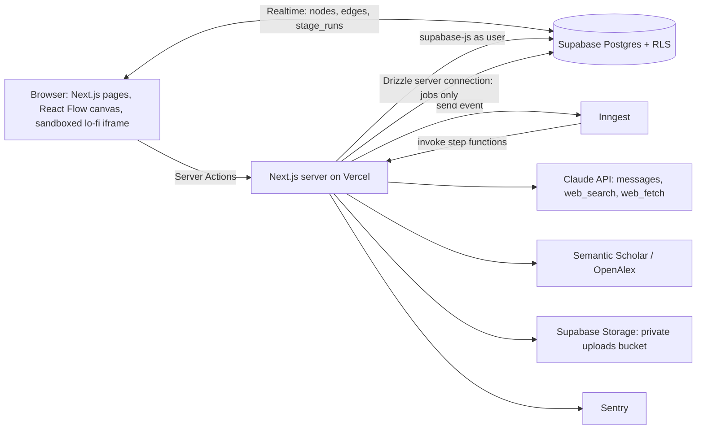
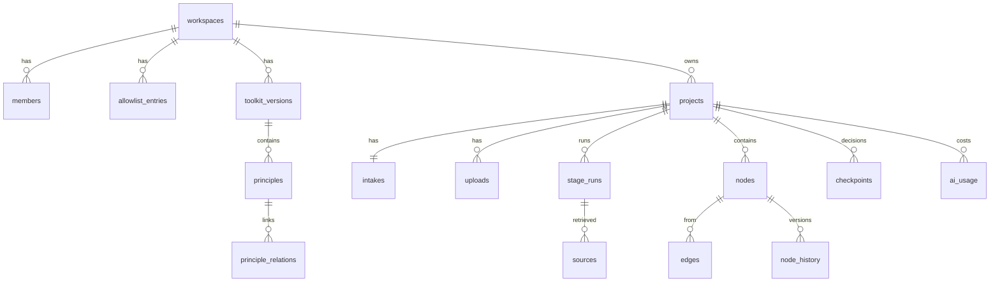

# 04: Tech spec

*Plain English: how Fluently will be built: the tools, the data, the server operations, how errors are handled and how it's tested.*

Feature: Fluently MVP | Platform: web app | Version: 1 | Date: 2026-11-16 | Status: approved

## 1. Overview

A Next.js web app on Supabase (Postgres, Auth, Storage, Realtime). Each pipeline stage (ethics, research, solutions, lo-fi, test plan) runs as a durable background job (Inngest) that calls Claude and literature APIs, writes **nodes and edges** to Postgres, and streams progress to the canvas through Supabase Realtime. Trust rules (valid principle ID, citation must be a stored source, confidence rule) are enforced in code, not only in prompts. Product source of truth: [01-prd.md](01-prd.md), [02-requirements.md](02-requirements.md), [03-ux-flows.md](03-ux-flows.md), [03b-design-direction.md](03b-design-direction.md).

## 2. Stack and decisions

Versions checked on npm on 2026-11-16; pin exact versions at scaffold (T0.1) and update this table if they differ.

| Layer | Choice | Version |
|---|---|---|
| Framework | Next.js App Router, React, TypeScript strict | next 16.4.6, react 19.3.0, typescript 5.9.3 (create-next-app pins TS 5; TS 7 not yet supported by Next's tooling) |
| UI | Tailwind CSS v4 + shadcn/ui (CLI 4.x), Lucide icons | tailwindcss 4.3.3 |
| Canvas | React Flow (`@xyflow/react`) | 13.0.x |
| Forms / validation | React Hook Form + Zod | zod 4.x |
| Backend | Supabase: Postgres 17, Auth (`@supabase/ssr`), Storage, Realtime | supabase-js 2.119.x, @supabase/ssr 0.12.x, CLI 3.2.x |
| DB schema + migrations | Drizzle ORM + drizzle-kit (RLS policies declared with `pgPolicy`) | drizzle-orm 0.45.x, drizzle-kit 0.31.x |
| Background jobs | Inngest | inngest 4.26.x |
| AI | Anthropic TypeScript SDK | @anthropic-ai/sdk 1.9.x |
| Literature | Semantic Scholar Graph API, OpenAlex API (plain `fetch`) | — |
| CSV | papaparse | latest |
| HTML sanitising (lo-fi) | sanitize-html | latest |
| PDF export (Should) | @react-pdf/renderer | 4.9.x |
| Tests | Vitest + Testing Library; Playwright | vitest 5.1.0, @playwright/test 1.63.0 (matches the preinstalled browser) |
| Quality | ESLint, Prettier, `tsc --noEmit`, GitHub Actions | — |
| Hosting | Vercel (app), Supabase cloud, Inngest cloud | — |
| Errors | Sentry (`@sentry/nextjs`) | 11.x |
| Package manager | pnpm | 10.x |

**Decisions**

| ID | Decision | Why | Rejected alternative |
|---|---|---|---|
| D1 | Web branch (Next.js + Supabase) as the PRD prefers | Pack platform is web; team conventions | — |
| D2 | **Inngest** for stage jobs, with one function per stage and one `step.run` per research step | Jobs run up to 30 min, need retries per step, cancellation, survive restarts, and Vercel functions time out; Inngest steps are durable and resumable | Supabase Edge Functions (wall-clock limits); self-hosted worker + pg-boss (extra server to run) |
| D3 | User-facing reads/writes go through **supabase-js with the user's session** (RLS enforced). Jobs use a **Drizzle client on a server-only connection** that bypasses RLS and always filters by `workspace_id` and `project_id` | RLS protects every user path; jobs need to write across tables in transactions | Drizzle for user requests with JWT claims set per transaction (more moving parts) |
| D4 | The graph is two tables, `nodes` and `edges`, with a typed `data jsonb` validated by a Zod schema per node type. Trace and stale propagation are recursive SQL functions | "Trace back to evidence" becomes one query; new node types need no migration | One table per node type (trace becomes many joins) |
| D5 | Supabase **Realtime** (`postgres_changes`, filtered by `project_id`) for live canvas updates on `nodes`, `edges`, `stage_runs` | Already in the stack, respects RLS | Polling (slower, more load) |
| D6 | All Claude calls go through one `AiClient` interface (`lib/ai/`) with a real implementation and a **fake** for tests. It sets model per stage, structured output schema, and logs usage on every call | Tests never spend money; usage logging can't be forgotten | Calling the SDK directly from each stage |
| D7 | Structured outputs with `output_config.format` (JSON schema generated from Zod), validated again with Zod; one retry on invalid output | NFR10; principle IDs and citation IDs are then checked in code | Free-text parsing |
| D8 | **Citation integrity by construction**: every retrieved item is stored as a `sources` row first and shown to the model as `S<n>`; the model may cite only those handles; unknown handles are dropped and logged | AC12.2–AC12.3, NFR4; 0 made-up citations | Asking the model to cite papers from memory, then verifying |
| D9 | **Principle validity by construction**: the model is given candidate principles as `P:<ID>`; outputs are checked against `principles` for the pinned version; external principles must cite a source handle | AC16.2, AC18.4 | Prompt-only rule |
| D10 | Confidence (High/Med/Low) and A/B sample size are **pure functions** in `lib/rules/` | AC12.6, AC21.2: deterministic, testable | Letting the model rate confidence |
| D11 | Lo-fi HTML is sanitised server-side (scripts, event handlers, external URLs removed), then rendered in `<iframe sandbox="allow-scripts" srcdoc>` (no `allow-same-origin`) with a CSP meta `default-src 'none'; style-src 'unsafe-inline'; img-src data:; script-src 'nonce-…'`; Fluently injects its own pin script, which talks to the parent via `postMessage` | NFR6: no cookie, storage or network access | Rendering in the page DOM; a separate origin (more hosting) |
| D12 | Optimistic concurrency on nodes with a `version int`; update succeeds only if the version matches | AC24.7 | Last write wins |
| D13 | Allowlist enforced twice: the sign-up Server Action checks `is_email_allowed()`, and a `before insert` trigger on `auth.users` raises if not allowed | AC1.2 holds even if someone calls the Auth API directly | Server Action check only |
| D14 | Motion with **CSS transitions and Tailwind variants only**, tokens in CSS variables; shadcn's `tw-animate-css` for dialogs. No Motion library | 03b uses no springs or gesture animation; fewer dependencies (deviation from frontend-conventions default) | Motion library |
| D15 | Analytics are rows in an `events` table; no third-party analytics | NFR13 says in-app; internal tool | PostHog |
| D16 | Models: `claude-haiku-5-5` default for every stage (development); demo preset sets `claude-sonnet-5-5` for synthesis, solutions, lo-fi and test plan, Haiku for extraction; `claude-opus-5-5` selectable per stage. Sonnet/Opus requests send server-side refusal fallbacks (`fallbacks: "default"`, beta `server-side-fallback-2026-07-01`). Effort is set explicitly per stage (`low` for extraction, `medium` for synthesis, `high` for lo-fi code); thinking left at adaptive (it can't be disabled on these models) | PRD §7 and brief §9; cost < £10 | Fixed model for all stages |
| D17 | Web research uses Claude's server tools `web_search` and `web_fetch` (`*_20260209` on Sonnet/Opus; the basic variants on models that don't support those). Literature uses Semantic Scholar first, OpenAlex as fallback, with a 15 s timeout per call | PRD: no scraping, no paid social APIs | Third-party search APIs |
| D18 | Uploaded images and PDFs are passed to Claude as base64 `image` / `document` blocks; CSV/XLSX/TXT are converted to text server-side; `.eml` parsed to HTML + subject | AC8.6, AC8.8, AC19.3 | Files API (adds lifecycle to manage) |
| D19 | Report export (Should) with `@react-pdf/renderer` for PDF and a Markdown serialiser over the same report model | Same content as SCR9 (AC15.4); runs in a serverless function | Headless Chromium on Vercel (heavy) |
| D21 | `cacheComponents` and `partialPrefetching` are **off** in `next.config.ts`; Next 16 middleware is `proxy.ts` | Every page is per-user and dynamic; the static-shell model would force Suspense around every session read for no benefit in an internal tool | Keeping Cache Components on |
| D22 | shadcn/ui components are written by hand in `components/ui/` on `radix-ui`, `class-variance-authority`, `tailwind-merge` (same structure as shadcn's) | The shadcn registry host is blocked from the build environment, so the CLI can't fetch them; npm is reachable | Waiting for network access to the registry |
| D24 | Lanes: each stage is a React Flow group node; cards are child nodes with `extent: 'parent'` and drag locked to the vertical axis; order saved in a `sort_order` column. Current assets cards (`asset_set` nodes) live in the Objectives lane and connect to Evidence. Handles use `isValidConnection` (next lane only, valid type pairs); edges are deletable with a midpoint button. Expanded cards are the same node with a taller `expanded` render | User chose lanes (2026-11-17); keeps left-to-right trace readable and the build simpler than a free canvas | Free-positioned nodes with a 'Tidy up' layout |
| D25 | Prototype hosting (2026-11-17): Vercel project `fluently` in team `cowry-test-10`, production URL https://fluently-psi.vercel.app, deployed from this workspace with the Vercel CLI (`vercel deploy --prod`), framework set in `vercel.json`. Supabase project `Fluently MVP` (ref `phoulxqlplcymicmvinv`, eu-central-1, free plan); migrations applied through the Management API and recorded in `supabase_migrations.schema_migrations`; GitHub auto-deploy and Supabase's GitHub integration off until work is merged to `main` | User wanted a clickable prototype quickly; no repository connection needed yet | Connecting GitHub for auto-deploys now |
| D26 | Free-plan email: Supabase's built-in sender can't use our templates, only delivers to members of the Supabase organisation, and sends a few emails per hour. `/auth/confirm` therefore accepts both our token-hash links and Supabase's default code links. Before teammates join, connect a custom SMTP provider (e.g. Resend) and switch back to our templates | Free plan limits (entitlement `auth.email_templates`) | Upgrading Supabase to Pro now |
| D23 | Desktop only: signed-in screens are laid out for 1024 px and up, with no phone/tablet breakpoints; below 1024 px a `DesktopOnly` gate in the `(app)` layout shows `app.desktopOnly` (CSS-only, no reload). This overrides the frontend conventions' mobile-first rule | User decision 2026-11-16; Fluently is a long-session desktop tool | Mobile-first responsive layouts |
| D27 | Sign out ends the session on this device only (`signOut({ scope: "local" })`); the landing page after sign-in is `/home`. Integration tests that list data run in their own workspace (`createIsolatedUser`) so repeated runs don't see each other's rows | Signing out of a laptop shouldn't sign someone out everywhere; found when two tests shared an account (2026-11-17) | Global sign-out |
| D28 | Prices in `lib/ai/models.ts` (USD per million tokens, checked 2026-11-17): Haiku 5.5 $0.10 in / $0.50 out / $0.01 cache read / $0.125 cache write; Sonnet 5.5 $2 / $10 / $0.10 / $2.50; Opus 5.5 $4 / $20 / $0.20 / $5. Haiku cache prices and web search ($10 per 1,000) are estimates to check against the live pricing page before real AI runs. Admin role and active changes go through `set_member_role` / `set_member_active` (security definer, last-admin guard, deactivation bans the auth user and deletes sessions) | Prices from the built-in API reference; the web search price wasn't listed there | Hard-coding prices in the cost code |
| D29 | Toolkit upload: the browser checks the file with `lib/toolkit/parse.ts` for an instant preview, and the server re-checks the same file before `save_toolkit_version` (one transaction: version, principles, connections, workspace default). Server Action body limit raised to 11 MB; the hosted prototype on Vercel still caps requests at 4.5 MB, so files there must be under about 4 MB (the real toolkit is far smaller). CSV parsing uses papaparse | No upload storage needed for a text file this size; one check function for browser and server | Uploading to Storage first and parsing in a background job |
| D30 | Prototype mode (2026-11-17): `getAiClient()` returns `FakeAiClient` unless `AI_MODE=live` and `ANTHROPIC_API_KEY` are set. The made-up answers live in `lib/ai/fake.ts` (they build plausible output from the inputs, e.g. keyword ethics rules) so the hosted prototype can use them; test-only fixtures stay in `tests/fixtures/ai/`. Fake calls log usage at $0. Jobs (J1 onwards) run through `lib/jobs/run.ts`: `JOBS_MODE=inline` (default) runs them on the server after the response with `after()`; `JOBS_MODE=inngest` sends Inngest events instead, once an Inngest account exists | User wants a clickable prototype before adding an Anthropic key or an Inngest account | Blocking the prototype on both accounts |
| D31 | Research (J2, 2026-11-17): steps toolkit → client data → papers → web → competitors → reviews → findings → synthesis. Sources get per-run handles (S1…, toolkit T1…); the Evidence card stores its groups and items in `data.groups`. A re-run soft-deletes earlier AI-made findings, themes, opportunities and gaps (people's cards stay). `retry_research(run, synthesis_only)` makes a new run with `retry_of` pointing at the old one, reusing its sources. In live mode the web steps fail until the web-search check (T6.1) picks a tool variant; papers use Semantic Scholar then OpenAlex. Note: `stage_runs.retry_of` was added in a custom migration; check the drizzle snapshot before the next `db:generate` | One job keeps cancellation, limits and retries in one place | Separate jobs per step |
| D32 | Slice 7 additions (2026-11-17): research questions live in `stage_runs.questions` (jsonb, written by J2 before retrieval, passed to the search steps); a `run_events` table (workspace_id, project_id, stage_run_id, kind, step, count, created_at) with member-read RLS, written only by the job through the service role, in the realtime publication; gap nodes carry `data.kind` = discovery or generative (chosen by the model, schema-checked); theme strength is computed by `lib/rules/confidence.ts` over the theme's findings' sources and stored in `nodes.confidence`; the report download runs in a route handler (`/projects/[id]/report/download?format=md|pdf`) over the same report model as SCR9 (D19) | AC11.9, AC11.10, AC12.11, AC13.5, AC15.4 | Log lines inside `stage_runs.steps` (no live per-event updates, grows unbounded) |
| D34 | Project delete (2026-11-17, AC7.8): admins only, checked in `deleteProject` and by the existing `projects_delete` policy; the person types the exact name. Uploaded files are removed from storage first (the storage rules need the project to exist), then the project row, whose contents cascade; `ai_usage.project_id` is set to null so usage totals stay right; a `project_deleted` event records who. A `projects_budget_guard` trigger stops non-admins changing `cost_cap_override_gbp` (AC7.9) | AC7.6–AC7.9, NFR7 | Soft delete with a 30-day bin (more to build; archive already covers 'might need it again') |
| D36 | Phase 1 scope (2026-11-19): emails only, each audited alone through three lenses (structure, content, visual) and six parts (subject, preheader, hero, body, CTAs, footer); report first, themes extracted from it; opportunities and everything after are paused, not deleted | AC31.x–AC33.x | A journey view across emails (icebox) |
| D37 | Email reading: `.eml` parsed with the existing `lib/uploads/eml.ts`; HTML parsed server-side into parts and measured facts (contrast, colours, CTA count and size, images and alt text) in `lib/email/*`, pure functions with unit tests | AC31.3, AC31.5 | Asking the model to measure |
| D38 | Mobile render (375 px): headless Chromium in a serverless function (spike S2 first), JavaScript off, network blocked except images the member switched on, public https only with size and time limits (no internal addresses), `.eml` inline images embedded. If the spike fails on Vercel, fall back to attached screenshots and say so | AC31.4 | Fetching remote images by default (tracking pixels count as real opens) |
| D39 | Email audit job (J8): per email, one structured output of findings (part, lens, verdict, principle key, quote or named element); code checks each quote appears in the email text, drops the rest and logs `quote_rejected`; visual findings are labelled 'read from the image', measured ones 'measured'; evidence strength uses `lib/rules/confidence.ts`; no impact score | AC31.6–AC31.8 | Free-text findings (can't be spot-checked fast) |
| D40 | Toolkit shortlist: code scores principles against the behavioural objective, audience and the email parts, keeps about 20 (plus any the member pins); the report lists them. The importer reads the real sheet layout (checked against the real file, 2026-11-20): no ID column, so the name is the key and IDs are generated in sheet order; rows with the same name are merged into one principle; rows with no name are left out; goal spellings are unified; thin principles (no summary, explanation or example) are kept and ranked lower; a list of these notices is saved with the version; later versions keep the ID of a principle with the same name (`lib/toolkit/keys.ts`) | AC31.6, AC33.5 | Sending all 111 principles every time |
| D43 | Spike S2 result (2026-11-20, P1.4): **the mobile render runs on Vercel.** Tested on the live site from outside, with a temporary token-protected route (since removed): HeadlessChrome 153 from `@sparticuz/chromium` 153.0.0 driven by `puppeteer-core` 25.18.1, Node 26, region iad1. Cold start about 3.1 s in total (browser launch about 2.5 s), warm calls about 0.5 s; pictures 23 KB to 120 KB. Needs `serverExternalPackages` and, for each route that renders, `outputFileTracingIncludes` for `./node_modules/@sparticuz/chromium/bin/**/*`. Images off: nothing is fetched (a content rule in the page, with a request filter behind it). Images on: an https image was fetched (status 200). Findings that changed the build: the page needs a phone-width viewport instruction or the browser lays out at desktop width (now added in `previewDocument`); `layoutWidth` is reported so a fixed 600 px email can be flagged as not responsive; positions shift with images (a button moved from 185 px to 355 px), so the fold must be measured from the render actually used. Still open for P1.5: shrink-to-fit for fixed-width emails, and safer image fetching (IB19) | AC31.4, AC31.5 | An external screenshot service (data leaves our control; cost per email) |
| D42 | Emails as built (2026-11-20, P1.2 and P1.3): an `emails` table (subject, preheader, HTML up to 1 MB, parts as saved JSON, who added it) and an `email` card type in the Objectives lane; `add_email` creates the card first and then the row that points at it, so members need only insert and delete rights, never update; 20 emails per project; files go to private storage as 'asset' uploads and the server reads the `.eml` or `.html` back from there. For email projects the brief needs at least one email (any mode) instead of an uploaded asset; Screens can't be chosen on New project but the server still accepts it, so older projects keep working | AC31.1–AC31.3, AC32.6 | Refusing 'screens' in `createProject` (breaks older projects and many tests for no gain) |
| D41 | Research questions live in their own table (project, position, text, who, when) with member-read and member-write rules and a two-user test; the run copies them onto `stage_runs.questions` so each run keeps what it used; statuses (Answered, Partly answered, No evidence found) are computed in code from linked sources | AC32.x | Keeping questions only on the run |
| D35 | Tree editing (2026-11-19, Slice 8): trace is `trace_path` (a recursive query over the saved lines, run as the member, each card visited once so loops can't run away); add, delete, restore, merge, connect and disconnect are database functions run as the member, so access rules apply to every row, and each returns a coded refusal (`P0004` locked while the stage runs, `P0006` can't connect, `P0007` link needed, `P0008` objective). Delete keeps the row for 60 seconds so Undo works; history can be told 'merged' or 'edited' by a transaction-local setting that only these functions use. *Regenerate stale* re-runs the research analysis through the send-back path (people's cards kept) rather than regenerating single cards, which stays open | AC23.1–AC24.8, AC30.x | A separate 'dirty' table for out of date marks (the `stale` flag on cards is enough) |
| D33 | AI budget (2026-11-17): J2 checks spend against the cap (project override, else workspace) before each AI step and sets `paused_cost`; `confirm_over_cap` (any member, recorded on the run) and `raise_project_cap` (admins) queue the run again and the job resumes from its unfinished steps. Ethics (one small call) isn't paused. The decision panel's size (AC25.5) is kept in the browser's local storage, so it is per person per browser. The integration test project maps `server-only` to an empty module so the PDF renderer can be tested | AC27.3, AC27.4, AC25.5 | A budget check in `AiClient` (would stop mid-step, breaking 'let the current step finish') |
| D20 | Email + password sign-in only (Supabase Auth) with email verification; local email captured by the Supabase stack's mail catcher | US1 | Magic links, SSO (later) |

## 3. Architecture



**Folders**
```
app/                      routes only (+ private _components folders)
  (auth)/sign-in, sign-up, reset
  (app)/projects, projects/[id]/(canvas|intake|report), projects/[id]/lofi/[nodeId]
  (app)/toolkit, settings
  api/inngest/route.ts    Inngest handler
components/ui/            shadcn
components/<area>/        canvas, intake, checkpoint, report, lofi, toolkit, settings (+ copy.ts per screen)
hooks/                    useRealtimeProject, useTrace, …
lib/schemas/              shared Zod (forms, node data per type, AI output)
lib/actions/              Server Actions (O1…)
lib/db/                   drizzle schema, server db client (jobs only)
lib/supabase/             server/browser clients, middleware helper
lib/ai/                   AiClient (real + fake), prompts/, usage logger, price table
lib/retrieval/            semanticScholar.ts, openAlex.ts (+ fakes)
lib/jobs/                 inngest client + functions: ethics, research, solutions, lofi, testplan, regenerate, enrich, purge
lib/rules/                confidence.ts, sampleSize.ts, principleCheck.ts, citationCheck.ts, staleness helpers
lib/lofi/                 sanitize.ts, pinScript.ts
supabase/                 config.toml, seed.sql
drizzle/                  generated migrations
fixtures/toolkit/         invented sample toolkit (CSV + JSON)
tests/                    unit, component, integration, rls
e2e/                      Playwright specs (FL*, FF*)
```

**Where logic lives:** UI and client state in components/hooks; all writes in Server Actions (validate → session → permission → act → typed result); multi-row writes that must be atomic in Postgres functions (`approve_checkpoint`, `merge_nodes`, `mark_downstream_stale`, `delete_node_soft`); AI and retrieval only inside Inngest steps or the coaching Server Action.

## 4. Data model

All tables: `id uuid pk default gen_random_uuid()`, `created_at`, `updated_at timestamptz default now()` (trigger updates `updated_at`), RLS enabled in the creating migration. All workspace data carries `workspace_id` (fk `workspaces`, `on delete restrict`).

| Table | Key fields (type, required, default) | Constraints / indexes |
|---|---|---|
| `workspaces` | name text!, cost_cap_gbp numeric! 10, gbp_per_usd numeric! 0.79, stage_models jsonb! (per-stage model id + effort), model_prices jsonb! (per model: input, output, cache read, cache write per MTok, web search per 1k), agency_services text[]! {'Implicit response test (IRT)','Behavioural interviews'}, sector_flag_list text[]! {gambling, high-interest credit, alcohol, addictive products}, sector_refuse_list text[]! {}, default_toolkit_version_id uuid null | cost_cap_gbp between 1 and 500 |
| `members` | id uuid! (= auth.users.id), workspace_id!, email text!, display_name text, role text! 'member', active bool! true, onboarded_at timestamptz | role in (admin, member); unique(email); idx workspace_id |
| `allowlist_entries` | workspace_id!, value text!, kind text!, created_by uuid! | kind in (email, domain); unique(workspace_id, lower(value)) |
| `toolkit_versions` | workspace_id!, number int!, file_name text!, uploaded_by!, principle_count int!, warnings jsonb! [] | unique(workspace_id, number) |
| `principles` | workspace_id!, version_id! (cascade), principle_key text! (the toolkit ID), name text!, general_goal!, sub_goal!, mechanism!, sense, quick_insight, extended_explanation, examples, link_to_paper, reference, design_lever, outcome, evidence, related_raw text, evidence_level text! | evidence_level in (strong, some, none); unique(version_id, principle_key); idx (version_id, general_goal, sub_goal) |
| `principle_relations` | version_id!, from_id!, to_id! | unique(from_id, to_id) |
| `principle_enrichments` (Should) | workspace_id!, principle_id!, kind text!, suggested text!, final text, status text! 'pending', decided_by, decided_at | kind in (channel_fit, when_not_to_use, outcome_behavioural, outcome_emotional); status in (pending, approved, rejected) |
| `toolkit_candidates` | workspace_id!, project_id!, name text!, mechanism text, source_id uuid! | |
| `projects` | workspace_id!, name text!, mode text!, channel text!, client_label text, toolkit_version_id null, status text! 'in_progress', current_stage text! 'intake', variants_per_rec int! 2, cost_cap_override_gbp numeric, archived_at, created_by!, updated_by! | name 1–80; mode in (new, optimise); channel in (screens, email); status in (in_progress, waiting, running, failed, complete, blocked); variants 1–3; idx (workspace_id, archived_at, updated_at desc) |
| `intakes` | project_id pk (cascade), business_objective text, behavioural_objective text, audience_context text, constraints text, sector text, sector_other text, figma_link text, low_specificity jsonb! {}, approved_at, approved_by, version int! 1 | lengths per 03 §6 |
| `uploads` | workspace_id!, project_id! (cascade), kind text!, storage_path text!, file_name!, mime!, size_bytes int!, uploaded_by! | kind in (asset, client_data); idx project_id |
| `stage_runs` | workspace_id!, project_id! (cascade), stage text!, status text! 'queued', steps jsonb! [], feedback text, replace_human bool! false, model text, inngest_run_id text, error_code text, started_at, finished_at, started_by! | stage in (ethics, research, solutions, lofi, testplan); status in (queued, running, succeeded, partial, failed, cancelled, paused_cost); idx (project_id, stage, created_at desc) |
| `nodes` | workspace_id!, project_id! (cascade), type text!, stage text!, title text!, data jsonb!, provenance text! 'ai', status text! 'ok', stale bool! false, confidence text, low_specificity bool! false, model text, stage_run_id, version int! 1, sort_order int! 0, created_by, updated_by, deleted_at | type in (objective, asset_set, ethics, source, finding, theme, opportunity, gap, recommendation, lofi_variant, annotation, test_plan, override, reference); provenance in (ai, ai_edited, human); status in (ok, failed, flagged, overridden, running); idx (project_id, type) where deleted_at is null |
| `edges` | workspace_id!, project_id! (cascade), from_id! (upstream, cascade), to_id! (downstream, cascade), kind text! 'built_from' | unique(from_id, to_id); idx from_id; idx to_id |
| `sources` | workspace_id!, project_id! (cascade), stage_run_id!, handle text! (e.g. S12), source_type text!, title text!, url text, upload_id, authors text[], year int, doi text, external_id text, excerpt text, retrieved_at! | source_type in (toolkit, paper, desk, competitor, social, upload); unique(stage_run_id, handle) |
| `node_history` | workspace_id!, node_id! (cascade), snapshot jsonb!, change text!, changed_by, | change in (created, edited, regenerated, merged, deleted, restored) |
| `checkpoints` | workspace_id!, project_id! (cascade), stage text!, decision text!, feedback text, selection uuid[], decided_by!, decided_at! | decision in (approve, send_back) |
| `ethics_overrides` | workspace_id!, project_id!, node_id!, rule text!, reason text!, decided_by! | char_length(reason) >= 20 |
| `ai_usage` | workspace_id!, project_id null, stage text!, step text!, model text!, input_tokens int!, output_tokens int!, cache_read_tokens int! 0, cache_write_tokens int! 0, web_searches int! 0, cost_usd numeric(10,5)!, duration_ms int!, success bool! | idx (project_id, stage) |
| `events` | workspace_id!, member_id null, name text!, props jsonb! {} | idx (workspace_id, name, created_at) |
| `project_ratings` | workspace_id!, project_id!, member_id!, rating int! | rating 1–5; unique(project_id, member_id) |



**Database functions** (security definer only where stated, `search_path` pinned):
- `is_email_allowed(email text) returns bool` (definer): true if email or its domain is in any workspace's allowlist, or equals the bootstrap admin email setting.
- `is_member(ws uuid) returns bool`, `is_admin(ws uuid) returns bool` (definer, stable): active membership checks used by policies.
- `trace_path(node uuid) returns setof uuid`: recursive CTE over `edges` upstream (to → from) until objective and source nodes.
- `mark_downstream_stale(node uuid) returns int`: recursive downstream, sets `stale = true`, returns count.
- `approve_checkpoint(project uuid, stage text, selection uuid[], feedback text, decision text)`: inserts checkpoint and updates project status atomically.
- `merge_nodes(ids uuid[], title text) returns uuid`, `soft_delete_node(id uuid) returns int`, `restore_node(id uuid)`.
- Trigger `auth_users_allowlist` on `auth.users` before insert: raise if `not is_email_allowed(new.email)`; after insert: create `members` row (first user when no workspace exists and email = bootstrap → creates workspace, role admin).

**RLS policies** (all default deny; signed-out users get nothing):

| Table | select | insert | update | delete |
|---|---|---|---|---|
| workspaces | is_member(id) | none (trigger only) | is_admin(id) | none |
| members | is_member(workspace_id) | none (trigger) | is_admin(workspace_id), or self for display_name/onboarded_at (column-limited via function) | none |
| allowlist_entries | is_admin | is_admin | none | is_admin |
| toolkit_versions, principles, principle_relations | is_member | is_admin | none (immutable, AC4.8) | none |
| principle_enrichments | is_member | none (jobs) | is_admin | none |
| projects, intakes, uploads, nodes, edges, checkpoints, ethics_overrides, toolkit_candidates, project_ratings | is_member | is_member (and `created_by/decided_by = auth.uid()` where present) | is_member (using + with check same workspace) | is_admin (projects); is_member (others) |
| stage_runs, sources, node_history, ai_usage | is_member | none (jobs, server connection) | none | none |
| events | is_admin | is_member and member_id = auth.uid() | none | none |

Example SQL (nodes):
```sql
alter table nodes enable row level security;
create policy nodes_select on nodes for select using (is_member(workspace_id));
create policy nodes_insert on nodes for insert with check (is_member(workspace_id) and provenance = 'human');
create policy nodes_update on nodes for update using (is_member(workspace_id)) with check (is_member(workspace_id));
create policy nodes_delete on nodes for delete using (is_member(workspace_id));
```
Storage: bucket `uploads` private; object path `<workspace_id>/<project_id>/<upload_id>`; policies check `is_member((storage.foldername(name))[1]::uuid)`; reads via signed URLs (60 s).

**Seed data** (`supabase/seed.sql`, development only): one workspace "Fluently Dev", allowlist `@fluently.test`, admin `admin@fluently.test` and member `member@fluently.test` (password `password-dev-123`), toolkit v1 from `fixtures/toolkit/sample-toolkit.csv` (30 invented principles, NFR9), one project at each stage with a small graph (for canvas, report and perf work).

## 5. Server operations

All Server Actions return `{ ok: true, data } | { ok: false, code }` with codes `validation | forbidden | not_found | conflict | unavailable | rate_limited | cost_cap`. Zod schemas live in `lib/schemas/`.

| ID | Operation | Input (Zod) | Who | Errors | ACs |
|---|---|---|---|---|---|
| O1 | signUp | {email, password ≥12} | anyone | validation, forbidden (not allowlisted) | AC1.1, AC1.2, AC1.7 |
| O2 | signIn / signOut | {email, password} | anyone | validation (generic message) | AC1.3, AC1.4, AC1.6 |
| O3 | requestPasswordReset / updatePassword | {email} / {password} | anyone | none surfaced (no enumeration) | AC1.5 |
| O4 | completeOnboarding | {} | member | — | AC2.2 |
| O5 | addAllowEntry / removeAllowEntry | {value} / {id} | admin | validation, forbidden | AC3.1–AC3.3 |
| O6 | setMemberRole / setMemberActive | {memberId, role} / {memberId, active} | admin | forbidden, conflict (last admin) | AC3.4, AC3.5 |
| O7 | updateWorkspaceSettings | {stageModels?, costCapGbp?, gbpPerUsd?, agencyServices?, sectorFlagList?, sectorRefuseList?} | admin | validation, forbidden | AC10.4, AC13.3, AC27.2, AC28.1–AC28.2 |
| O8 | previewToolkit | {file (csv/json ≤10 MB)} | admin | validation (row errors list) | AC4.1–AC4.4, AC4.7 |
| O9 | saveToolkitVersion | {previewToken} | admin | conflict (stale preview) | AC4.5, AC4.6 |
| O10 | createProject / archiveProject / unarchiveProject / deleteProject | {name, mode, channel, clientLabel?} / {id} | member (delete: admin) | validation, not_found | AC7.1, AC7.2, AC7.5, NFR7 |
| O11 | listProjects | {filter, search, cursor} | member | — | AC7.3, AC25.4 |
| O12 | saveIntakeField | {projectId, field, value, version} | member | validation, conflict | AC8.9 |
| O13 | coachField | {projectId, field, text} | member | unavailable (timeout 20 s) | AC8.2–AC8.5 |
| O14 | createUploadUrl / confirmUpload / removeUpload | {projectId, kind, fileName, mime, size} | member | validation (type/size/count) | AC8.6–AC8.8 |
| O15 | approveObjectives | {projectId} | member | validation (missing fields/assets), forbidden (refused sector) | AC9.1, AC9.2, AC10.1, AC10.4 |
| O16 | editApprovedIntake | {projectId} | member | — | AC9.3 |
| O17 | recordOverride | {nodeId, reason ≥20} | member | validation | AC26.1–AC26.3, AC10.3, AC16.3 |
| O18 | startStage | {projectId, stage, feedback?, replaceHuman?} | member | validation (prerequisites, no toolkit), cost_cap, conflict (already running) | AC11.1, AC4.9, AC27.4 |
| O19 | cancelStage / retryFailedSteps / retrySynthesis | {stageRunId} | member | not_found | AC11.5–AC11.7 |
| O20 | decideCheckpoint | {projectId, stage, decision, selection[], feedback?, replaceHuman?} | member | validation (≥1 selected, feedback ≥10) | AC14.2, AC14.3, AC17.4, AC20.2, AC21.3, AC25.1–AC25.3 |
| O21 | updateNode | {nodeId, patch, version} | member | validation, conflict, forbidden (locked while running) | AC24.1, AC24.7, AC11.8 |
| O22 | addNode | {projectId, type, data, links[]} | member | validation (type/column, required links, principle) | AC24.2, AC17.2, AC17.3 |
| O23 | deleteNode / undoDelete | {nodeId} | member | forbidden (objective) | AC24.5, AC24.8 |
| O34 | connectNodes / disconnectNodes / reorderNode | {fromId, toId} / {edgeId} / {nodeId, sortOrder} | member | validation (`cant_connect`, `link_required`), conflict | AC30.1–AC30.7, AC22.8 |
| O36 | splitAssetSet / moveAsset / renameNode | {nodeId, assetIds[]} / {assetId, toNodeId} / {nodeId, title} | member | validation, conflict | AC22.11 |
| O35 | addSource | {projectId, upload or url} | member | validation (type/size), unavailable | AC12.10 |
| O24 | mergeNodes | {nodeIds[], title} | member | validation (same type) | AC24.6 |
| O25 | regenerateNode / regenerateStale | {nodeId, feedback?} / {projectId} | member | cost_cap | AC24.3, AC24.4, AC18.4, AC18.8 |
| O26 | getTrace | {nodeId} | member | not_found | AC23.1, AC23.2 |
| O27 | getReport | {projectId} | member | not_found | AC15.1–AC15.3, AC12.8 |
| O28 | exportReport (Should) | {projectId, format} | member | unavailable | AC15.4 |
| O29 | setBaseline | {projectId, metric, rate 0.1–99.9} | member | validation | AC21.2 |
| O30 | rateProject | {projectId, rating 1–5} | member | conflict (already rated) | NFR12 |
| O31 | raiseProjectCap / confirmOverCap | {projectId, capGbp} / {projectId} | admin / member | forbidden | AC27.4 |
| O32 | decideEnrichment (Should) | {id, decision, final?} | admin | — | AC6.2 |
| O33 | logEvent (internal helper, called by other operations) | {name, props} | member | — | NFR13 |

**Background jobs (Inngest functions)**

| Job | Trigger event | Steps | ACs |
|---|---|---|---|
| J1 ethicsGate | `stage/ethics.requested` | screen (AI, structured: pass/flag + reasons per rule) → write ethics node | AC10.1–AC10.5 |
| J2 research | `stage/research.requested` | toolkit candidates → papers (Semantic Scholar → OpenAlex) → desk (web_search) → competitive (web_search) → social (web_search) → uploads → extract findings per source batch → synthesis (themes, opportunities, principle candidates) → confidence + gaps (code) | AC11.x, AC12.x, AC13.x |
| J3 solutions | `stage/solutions.requested` | per opportunity: generate → principle check → retry once → ethics check | AC16.x |
| J4 lofi | `stage/lofi.requested` | per recommendation × N variants: generate HTML + annotations → sanitise → validate annotations → same-principle check → ethics check | AC18.x, AC19.x |
| J5 testplan | `stage/testplan.requested` | generate plan → sample size (code) → ask for baseline if missing | AC21.x |
| J6 regenerateNode | `node/regenerate.requested` | rebuild from inputs + feedback; history snapshot | AC24.3 |
| J7 enrichToolkit (Should) | `toolkit/enrich.requested` | suggestions per principle (batched) | AC6.1 |
| J8 purgeProject | `project/deleted` | delete storage objects and rows | NFR7 |

Every job: checks `stage_runs.status` for cancellation before each AI call; checks cost cap before each AI call (pauses with `paused_cost`); writes step status to `stage_runs.steps`; retries a failing step 2× with backoff (Inngest retries), then marks the step failed and continues; overall timeout 30 min (NFR8).

## 6. Auth and permissions

- Email + password with verification (Supabase Auth); sessions in cookies via `@supabase/ssr`, refreshed in `middleware.ts`; protected route group `(app)` redirects signed-out users to `/sign-in?next=…` (AC1.6).
- Roles: **admin** (all member rights + allowlist, members, settings, toolkit upload, enrichment decisions, project delete, raise cost cap); **member** (all project work, read toolkit, read usage).
- Deactivated members: `active = false` makes `is_member()` false (RLS denies immediately) and the middleware signs them out on next request (AC3.4 within 5 min is met by token refresh interval ≤ 5 min).
- `BOOTSTRAP_ADMIN_EMAIL` env var is copied into `private.app_config` by `scripts/set-bootstrap-admin.ts` (triggers can't read env vars); `is_email_allowed` and the auth trigger read it there for the very first account (AC1.7).

## 7. Client state and data flow

- Server Components fetch lists and pages (projects, report, settings, toolkit).
- Canvas: initial graph loaded on the server; client subscribes to Realtime (`useRealtimeProject`) for `nodes`, `edges`, `stage_runs` of that project and merges changes into a local store (React state via `useReducer`). Layout is computed in code: column by node type, rows by stage order then created_at (deterministic, no auto-layout library).
- Mutations via Server Actions; optimistic only for: node title/body edits (rolled back on `conflict` or failure with `[canvas.editConflict]` / `[common.saveFailed]`), and delete (Undo restores).
- Intake autosave: debounce 2 s, sends `version`; on failure keeps text and shows `[common.saveFailed]`; offline detection with `navigator.onLine` + failed fetch → `[common.offline]`, retries on `online` event (FF13).
- Session expiry: Server Action returns `forbidden` with `session_expired` → modal sign-in (FF14), editor state retained in memory.
- Coaching: client calls `coachField` on blur, with a 20 s abort.

## 8. Error handling

| FF / EC | Detected by | System does | User sees (SCR · state) | Logged | Recovery |
|---|---|---|---|---|---|
| FF1 | O1 allowlist check / trigger; Supabase expired OTP error | No account; refuse link | SCR1 · not allowlisted / link expired | event | Ask admin; resend |
| FF2 | O13 timeout 20 s or error | Keep text | SCR6 · coaching unavailable | ai_usage (failed), Sentry | Continue |
| FF3 | O14 Zod (mime, size, count) | Reject file | SCR6 · upload rejected | — | Choose another |
| FF4 | J1 result flag / J1 failure | Block research | SCR6/SCR5 · ethics flagged / check failed | stage_runs | Edit, override, retry |
| FF5 | Step throws after 2 retries | Step failed, continue | SCR8 · partial failure | stage_runs.steps, Sentry | Retry failed steps |
| FF6 | Synthesis fails / Inngest timeout 30 min / worker loss | Stage failed, keep nodes | SCR8 · failed | Sentry | Retry synthesis |
| FF7 | principleCheck() false after retry | Drop item | SCR5 node `[rec.noneValid]` | event principle_check_failed | Regenerate / add |
| FF8 | sanitise > 500 KB, iframe `error` postMessage, no valid annotations | Variant failed | SCR10 · render failed | event | Regenerate |
| FF9 | O8 validation | Nothing saved | SCR11 · preview invalid | — | Fix file |
| FF10 | O21 version mismatch | Refuse save | SCR7 · save conflict | — | See latest |
| FF11 | O23 | Soft delete + stale, undo 10 s | SCR5 toast | node_history | Undo |
| FF12 | cost check in O18/O25/jobs | Pause (`paused_cost`) | SCR8 · cost at cap | event | Confirm / raise cap |
| FF13 | fetch failure / offline | Keep local edits, retry | `[common.offline]`, `[common.saveFailed]` | — | Try again |
| FF14 | `session_expired` code | Modal sign-in | `[common.sessionExpired]` | — | Sign in |
| FF15 | CSP blocks request | Nothing | grey placeholder | — | — |
| EC1 | project.toolkit_version_id ≠ default | Keep pinned | SCR5 header note | — | — |
| EC2 | no toolkit version | O18 returns validation `no_toolkit` | SCR3 banner / SCR8 `[toolkit.noneYet]` | — | Admin uploads |
| EC3 | 0 papers | Step succeeds with 0 | SCR8 "0 papers found" | — | — |
| EC4 | all Low | Note in checkpoint | SCR8 `[checkpoint.allLow]` | — | — |
| EC5 | contradiction flag from synthesis output (sources marked agree/contradict) | Low + gap | SCR7 | — | — |
| EC6 | = FF10 | | | | |
| EC7 | O16 → `mark_downstream_stale` on objective nodes | Stale all downstream | SCR5 stale | node_history | Regenerate stale |
| EC8 | member inactive | Job continues (server connection) | — | — | — |
| EC9 | sector in refuse list in O15 | Project status `blocked` | SCR6 refused sector | event | Archive |
| EC10 | — | Privacy hint shown | SCR6 hint | — | — |
| EC11 | principleCheck() | Reject | as FF7 | event | — |
| EC12 | same primary principle across siblings | Regenerate once / warn | SCR10 same principle | — | Regenerate |
| EC13 | `replace_human=false` default | Keep human nodes on re-run | — | — | — |
| EC14 | node count > 1,000 | Disable minimap animation; offer list view | SCR5 | — | List view |
| EC15 | J5 output baseline null | Ask | SCR8 needs baseline | — | O29 |
| EC16 | `merge_nodes` unions edges | — | — | node_history | Undo not offered (merge confirm dialog) |
| EC17 | synthesis returns external principle with source handle | Candidate row | SCR11 candidates | — | — |
| EC18 | job independent of browser | — | SCR5 on return | — | — |
| EC19 | paper without abstract | Source stored, excluded from extraction | — | — | — |
| EC20 | prompts instruct English output and `(translated)` marker | — | — | — | — |
| EC21 | label dedupe in node badge renderer | — | — | — | — |
| EC22 | O23 type check | Refuse | `[canvas.cantDeleteObjective]` | — | Edit intake |

## 9. Non-functional requirements

| NFR | How it's met | How it's checked |
|---|---|---|
| NFR1 | Server Components, paginated lists (25), no client fetch on first paint | `e2e/perf.spec.ts` LCP via PerformanceObserver ≤ 2 000 ms on seeded data (Chromium, no throttling, CI) |
| NFR2 | React Flow with `onlyRenderVisibleElements`, memoised node components, trace via SQL function | `e2e/perf.spec.ts` seeded 500-node project opens ≤ 3 s; `tests/integration/trace.test.ts` 1,000-node trace ≤ 300 ms |
| NFR3 | Semantic HTML, shadcn primitives, list view of canvas, live regions, focus rings, reduced-motion variants | `@axe-core/playwright` on every screen state (`e2e/a11y.spec.ts`); manual VoiceOver checklist (T15.2) |
| NFR4 | D8 | `tests/unit/citationCheck.test.ts`; spot-check view |
| NFR5 | RLS on every table; service keys server-only | `tests/rls/*.test.ts` two-user tests; CI `gitleaks` scan; lint rule bans `SUPABASE_SERVICE_ROLE_KEY` import under `components/` and `app/` client files |
| NFR6 | D11 | `e2e/lofi-sandbox.spec.ts` |
| NFR7 | Private bucket; J8 purge | `tests/integration/purge.test.ts` |
| NFR8 | Inngest durability, 30 min timeout | `tests/integration/jobs-timeout.test.ts` (Inngest test engine) |
| NFR9 | Fixture only | CI step `scripts/check-toolkit-fixture.sh` fails if any file under `fixtures/toolkit` > 100 KB or any `*.csv` outside fixtures contains the header `Quick Insight Summary` |
| NFR10 | D7 | `tests/unit/ai-schemas.test.ts` |
| NFR11 | Usage log + price table; Haiku extraction | Manual: usage on success-test briefs (T7.6) |
| NFR12 | Checkpoint panel, state matrix, rating | Moderated session (T15.4); `e2e/flows.spec.ts` click count intake→research ≤ 2 |
| NFR13 | `logEvent` in each operation | `tests/integration/events.test.ts` one assertion per event |
| Errors | Sentry server + client, PII scrubbing (emails removed) | Test error appears in Sentry (T15.5) |
| Privacy | Personal data: `members.email`, `members.display_name`, `events.member_id`, uploads content (client data). Retention: until project or member deleted; purge within 24 h | T15.6 |

## 10. Integrations and configuration

| Service | Use | Notes |
|---|---|---|
| Supabase | DB, Auth, Storage, Realtime | local via `supabase start` (Docker) |
| Inngest | jobs | local `npx inngest-cli dev` |
| Anthropic API | all AI | key server-only |
| Semantic Scholar | papers | key optional (higher rate limit) |
| OpenAlex | papers fallback | polite pool via `mailto` param (generic team address, OQ11) |
| Sentry | errors | DSN public is fine |
| Vercel | hosting | preview per branch |

`.env.example`
```
NEXT_PUBLIC_SUPABASE_URL=
NEXT_PUBLIC_SUPABASE_ANON_KEY=
SUPABASE_SERVICE_ROLE_KEY=
DATABASE_URL=
BOOTSTRAP_ADMIN_EMAIL=
ANTHROPIC_API_KEY=
AI_MODE=fake            # fake | live
SEMANTIC_SCHOLAR_API_KEY=
OPENALEX_MAILTO=
INNGEST_EVENT_KEY=
INNGEST_SIGNING_KEY=
NEXT_PUBLIC_SENTRY_DSN=
SENTRY_AUTH_TOKEN=
```

## 11. Testing strategy

| AC kind | Test kind | Where |
|---|---|---|
| Rules (confidence, sample size, principle/citation checks, toolkit parsing, sanitiser) | Unit (Vitest) | `tests/unit/` |
| Server operations (valid, invalid, forbidden, each failure) | Integration against local Supabase | `tests/integration/O<n>-*.test.ts` |
| RLS | Two-user tests | `tests/rls/<table>.test.ts` |
| Screen states and copy | Component (Testing Library), query by role/label | `tests/components/SCR<n>-*.test.tsx` |
| Flows FL/FF | Playwright at desktop 1280 (and 1024 for the narrowest supported width) | `e2e/FL<n>.spec.ts`, `e2e/FF<n>.spec.ts` |
| Jobs | Inngest test engine (`@inngest/test`) with FakeAiClient and fake retrieval | `tests/jobs/` |
| Accessibility | axe per state | `e2e/a11y.spec.ts` |

Commands: `pnpm lint`, `pnpm typecheck`, `pnpm test` (unit + component), `pnpm test:int` (needs `supabase start`), `pnpm test:e2e -- --trace off`, `pnpm db:reset` (reset + migrate + seed). AI is faked whenever `AI_MODE=fake` (default in tests): FakeAiClient returns canned, schema-valid outputs from `tests/fixtures/ai/*.json`, plus deliberately bad ones (unknown principle, unknown citation, malformed JSON) for failure tests.

## 12. Technical risks and spikes

| Risk | Spike / mitigation |
|---|---|
| Web search / fetch tool variant on Haiku 5.5 is undocumented here | Spike S1 (T6.1): one live call per variant on `claude-haiku-5-5`; record which works in this file; fall back to Sonnet for the web steps if neither does |
| Research quality vs the team (A1) | Slice 7 runs the success-test briefs before lo-fi is built |
| Cost per project (A3) | Usage log from the first AI call; Slice 7 measures |
| Semantic Scholar rate limits without a key | Backoff + OpenAlex fallback; request key (OQ11) |
| Lo-fi HTML quality and size | Size cap 500 KB; greyscale component vocabulary in the prompt; regenerate |
| Realtime volume during research (hundreds of inserts) | Batch inserts per step; client throttles re-layout to 1/250 ms |
| Supabase local stack in CI (Docker) | CI uses `supabase/setup-cli` + `supabase start` |

## 13. Traceability

| AC group | Operation / job / component | Test |
|---|---|---|
| AC1.x | O1–O3, trigger `auth_users_allowlist`, SCR1 | `tests/integration/O1-signup.test.ts`, `e2e/FL1.spec.ts`, `e2e/FF1.spec.ts` |
| AC2.x | O4, SCR2, SCR8 | `tests/components/SCR2-onboarding.test.tsx`, `e2e/FL1.spec.ts` |
| AC3.x | O5, O6, SCR12 | `tests/integration/O5-allowlist.test.ts`, `tests/integration/O6-members.test.ts`, `tests/rls/allowlist.test.ts` |
| AC4.x | O8, O9, SCR11 | `tests/unit/toolkitParse.test.ts`, `tests/integration/O9-toolkit.test.ts`, `e2e/FL7.spec.ts`, `e2e/FF9.spec.ts` |
| AC5.x, AC6.x | toolkit browser, O32, J7 | `tests/components/SCR11-browser.test.tsx`, `tests/jobs/J7.test.ts` |
| AC7.x | O10, O11, SCR3, SCR4 | `tests/integration/O10-projects.test.ts`, `tests/components/SCR3-projects.test.tsx` |
| AC8.x | O12–O14, SCR6 | `tests/integration/O13-coach.test.ts`, `e2e/FL2.spec.ts`, `e2e/FF2.spec.ts`, `e2e/FF3.spec.ts` |
| AC9.x, AC10.x | O15, O16, J1 | `tests/jobs/J1-ethics.test.ts`, `e2e/FF4.spec.ts` |
| AC11.x | O18, O19, J2 | `tests/jobs/J2-research.test.ts` |
| AC12.x, AC13.x | J2, `lib/rules/confidence.ts`, `citationCheck.ts` | `tests/unit/confidence.test.ts`, `tests/unit/citationCheck.test.ts`, `e2e/FL3.spec.ts`, `e2e/FF5.spec.ts` |
| AC14.x | O20, SCR8 | `tests/components/SCR8-checkpoint.test.tsx` |
| AC15.x | O27, O28, SCR9 | `tests/components/SCR9-report.test.tsx`, `tests/integration/O28-export.test.ts` |
| AC16.x, AC17.x | J3, O22, `principleCheck.ts` | `tests/jobs/J3-solutions.test.ts`, `tests/unit/principleCheck.test.ts`, `e2e/FL4.spec.ts` |
| AC18.x, AC20.x | J4, SCR10, `lib/lofi/*` | `tests/jobs/J4-lofi.test.ts`, `tests/unit/sanitize.test.ts`, `e2e/FL5.spec.ts`, `e2e/lofi-sandbox.spec.ts` |
| AC19.x | J4 email branch | `tests/jobs/J4-email.test.ts` |
| AC21.x | J5, O29, `sampleSize.ts` | `tests/unit/sampleSize.test.ts`, `e2e/FL6.spec.ts` |
| AC22.x | Canvas, list view | `tests/components/SCR5-canvas.test.tsx`, `e2e/a11y.spec.ts` |
| AC23.x | O26, `trace_path` | `tests/integration/trace.test.ts` |
| AC24.x | O21–O25, DB functions | `tests/integration/O21-O25-nodes.test.ts`, `e2e/FF10.spec.ts`, `e2e/FF11.spec.ts` |
| AC25.x | O20, `approve_checkpoint` | `tests/integration/O20-checkpoint.test.ts` |
| AC26.x | O17 | `tests/integration/O17-override.test.ts` |
| AC27.x, AC28.x | AiClient usage logger, O7, O31 | `tests/unit/cost.test.ts`, `tests/integration/O31-cap.test.ts`, `e2e/FF12.spec.ts` |
| AC29.x | J4 references | `tests/jobs/J4-references.test.ts` |
